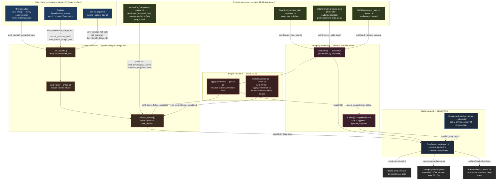
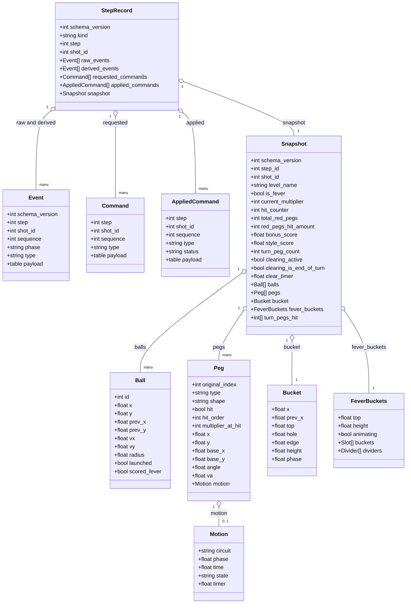

# Gameplay Event Pipeline (Phase 1)

Visual reference for the deterministic gameplay event/command pipeline
introduced in commit `36c9701` (`feat: event pipeline phase 1`). These
diagrams are generated from the actual implementation in `src/engine/core.lua`
(`stepSimulation` / `finalizeStep`), `src/systems/gameplay_events.lua`,
`src/systems/gameplay_commands.lua`, `src/systems/style_shots.lua`,
`src/systems/slide_inversion.lua`, `src/systems/ball_state.lua`,
`src/systems/simulation_snapshot.lua`, and
`src/systems/gameplay_trace_exporter.lua`.

See [Architecture](architecture.md) for the prose description of each module
and the [stepSimulation phase table](architecture.md#stepsimulation-phases-26-phases).

---

## 1. Data-flow pipeline

How a single fixed step's data moves from physical observation, through the
append-only journal and command buffer, to authoritative state mutation and
canonical trace export. Payloads are validated and deep-copied at every
ownership boundary — producers can never rewrite history after `emit`/`push`.



**Key invariants visible in the diagram**

- The **raw phase** is produced by physics, bucket resolution, and ball
  management only. Physics never mutates `peg.hit` — that authority belongs to
  `reducePegContacts` (phase 10).
- **`seal_raw()` (phase 16)** is the strict boundary between observation and
  inference. No raw event can be appended after it; no derived event can be
  appended before it.
- **`peg_scored` is buffered** during phase 10 (reading the borrowed raw view)
  and emitted as derived in phase 17, so the derived stream preserves raw
  source order via `source_sequence`.
- **Commands are requested by processors but applied only by the Engine**, in
  insertion order, once per step (phase 20). `shot_completed` (phase 21) runs
  after command application so its `total_score` is authoritative.
- Every retained consumer (timeline, trace exporter, `onStepFinalized`)
  receives a **detached deep copy** via `snapshot()` — never an alias into the
  working journal.

---

## 2. The 26-phase `stepSimulation` timeline

The strict deterministic ordering of one fixed step (`dt = 1/60`). Every code
path — including the `clearing` early-return and the unlaunched-balls skip —
reaches the `finalize` label so phases 16-26 always run and produce a
consistent step record.

```mermaid
flowchart TD
    classDef raw      fill:#1f3a5f,color:#fff,stroke:#4a7fc1
    classDef seal     fill:#3a2a1f,color:#fff,stroke:#c1844a
    classDef derived  fill:#2f3a1f,color:#fff,stroke:#9bc14a
    classDef apply    fill:#3a1f1f,color:#fff,stroke:#c14a4a
    classDef capture  fill:#1f2a3a,color:#fff,stroke:#4a7fc1
    classDef finish   fill:#2a2a2a,color:#fff,stroke:#888
    classDef early    fill:#3a1f2a,color:#fff,stroke:#c14a7f,stroke-dasharray:4 3

    P1["1 · begin_step<br/>open Events/Commands; flush staged"]:::raw
    P2["2 · Register un-IDed active balls"]:::raw
    P3["3 · time_step + ultra-fever check"]:::raw
    P4["4 · Bucket motion (skipped in fever)"]:::raw
    P5{"5 · clearQueue<br/>active?"}:::early
    P6["6 · Circuits update"]:::raw
    P7["7 · Physics.update → raw ball_contacted_peg<br/>(observational; no peg.hit)"]:::raw
    P8["8 · Stamp draw_path path_step"]:::raw
    P9{"9 · all balls<br/>launched?"}:::early
    P10["10 · Reduce peg contacts<br/>first-hit scoring · multiplier · fever ·<br/>stage green spawns · buffer peg_scored"]:::raw
    P11["11 · Bucket/fever resolution<br/>raw bucket/fever events + mode callbacks"]:::raw
    P12["12 · Fall-out detection → raw ball_fell_out"]:::raw
    P13["13 · Remove balls (stable order); notify BallState"]:::raw
    P14["14 · Spawn power balls (from phase 10 specs)<br/>→ raw ball_spawned; physics next step"]:::raw
    P15["15 · Shot-end detection<br/>(no active balls → startClearing or pending)"]:::raw

    FIN["finalize label — every path reaches here"]:::seal
    P16["16 · seal_raw() — freeze raw phase"]:::seal
    P17["17 · Emit buffered peg_scored (derived, source order)"]:::derived
    P18["18 · StyleShots → push award_style_points"]:::derived
    P18b["18b · SlideInversion → push remove_slide_pegs<br/>(skipped during clearing)"]:::derived
    P19["19 · BallState → derived ball_became_idle / reactivated /<br/>all_balls_became_idle / no_score_timeout_reached + push command"]:::derived
    P20["20 · Apply commands in order<br/>style→score, midturn clear; emit style_awarded"]:::apply
    P21["21 · shot_completed (if shot_end_pending)<br/>AFTER commands → authoritative totals"]:::derived
    P22["22 · SimulationSnapshot.capture (if trace/timeline)"]:::capture
    P23["23 · Assemble StepRecord; retain timeline; export trace"]:::capture
    P24["24 · onStepFinalized callback (read-only, deep copy)"]:::capture
    P25["25 · Shot-end handoff → finalizeShotTimeline + onTurnEnd"]:::finish
    P26["26 · finish_step / clear commands"]:::finish

    P1 --> P2 --> P3 --> P4 --> P5
    P5 -- "yes: updateClearing → goto finalize" --> FIN
    P5 -- "no" --> P6 --> P7 --> P8 --> P9
    P9 -- "no → goto finalize" --> FIN
    P9 -- "yes" --> P10 --> P11 --> P12 --> P13 --> P14 --> P15 --> FIN

    FIN --> P16 --> P17 --> P18 --> P18b --> P19 --> P20 --> P21 --> P22 --> P23 --> P24 --> P25 --> P26
```



**Critical ordering rules**

- **Phase 10 runs before 18/18b/19** so `StyleShots`, `SlideInversion`, and
  `BallState` see the complete derived `peg_scored` stream.
- **Phase 16 (seal)** strictly separates raw observation from derived
  inference.
- **Phase 20 (apply)** runs after all processors have pushed commands, so
  engine state is mutated only once per step.
- **Phase 21 (`shot_completed`)** runs after command application, so its
  `total_score` includes style awards granted on the shot's final step.
- **Phases 12-14** ensure green-spawned balls do **not** participate in the
  same step's scoring or resolution — they begin physics on the next step.
- The `goto finalize` pattern guarantees phases 16-26 always execute, even for
  the clearing early-return and the unlaunched-balls skip.

---

## 3. `StepRecord` / canonical trace structure

The shape of one JSONL line written by `GameplayTraceExporter.export_step`
(plus the in-memory retained timeline). Every field is plain scalar data — no
live entity references, functions, userdata, or NaN/inf ever appear. The
encoder emits object keys in sorted order and numbers at full precision
(`%.17g`), so two runs of the same replay under the same runtime/config/seed
produce byte-identical traces.



### Raw event types (phase 1-15)

| `type` | Producer | Key payload |
|--------|----------|-------------|
| `ball_launched` | staged at input, flushed phase 1 | `ball_id`, `x`, `y`, `vx`, `vy` |
| `ball_contacted_peg` | Physics (phase 7) | `ball_id`, `peg_id`, `contact_kind`, `did_bounce`, `impact_x/y` |
| `ball_contact_ball` | Physics (phase 7) | `ball_id`, `other_ball_id`, `contact_kind`, `did_bounce`, `normal_x/y`, in/out velocities for both balls |
| `bucket_caught_ball` | Bucket resolve (phase 11) | `ball_id`, `x/y`, `in/out_vx/vy`, `bucket_x` |
| `bucket_bounced_ball` | Bucket resolve (phase 11) | `ball_id`, `x/y`, `in/out_vx/vy`, `bucket_x` |
| `fever_bucket_caught_ball` | FeverBuckets (phase 11) | `ball_id`, `x/y`, `value` |
| `ball_fell_out` | fall-out (phase 12) | `ball_id`, `x/y`, `reason` |
| `ball_spawned` | power spawn (phase 14) | `ball_id`, `source`, `x/y`, `vx/vy` |

### Derived event types (phase 17+)

| `type` | Producer | Key payload |
|--------|----------|-------------|
| `peg_scored` | reduce (buffered p10, emitted p17) | `source_sequence`, `ball_id`, `peg_id`, `hit_order`, `multiplier_at_hit`, `peg_value` |
| `ball_became_idle` / `ball_reactivated` | BallState (p19) | `ball_id` |
| `all_balls_became_idle` | BallState (p19) | — |
| `no_score_timeout_reached` | BallState (p19) | `elapsed` |
| `style_awarded` | applyCommands (p20) | `ball_id`, `style`, `points`, `distance`, `peg_id`, `source_sequences` |
| `slide_peg_removed` | applyCommands (p20) | `ball_id`, `line_id`, `peg_id`, `reason` |
| `shot_completed` | emitShotCompleted (p21) | `completion_reason`, `initial/final_step`, `peg/bonus/style/total_score` |

### Command types

| `type` | Pushed by | Applied effect |
|--------|-----------|----------------|
| `award_style_points` | StyleShots (p18) | adds `engine.styleScore`; emits `style_awarded`; fires `onStyleShot` |
| `remove_slide_pegs` | SlideInversion (p18b) | removes the lowest already-hit peg(s) of a zero-gap slide line from the board; emits `slide_peg_removed`; `ignored_duplicate` when none remain |
| `start_midturn_clearing` | BallState (p19) | idempotent — starts clearing cascade, or `ignored_duplicate` if already active |

---

## How to capture a real trace

```bash
# Capture the canonical gameplay trace for your last shot
love . -- --replay src/replays/last_shot.lua \
  --export-gameplay-traces temp/debug_gameplay.jsonl \
  --retain-shot-timeline

# Headless + benchmark with full event data
love . -- --bench --headless --export-gameplay-traces temp/bench_gameplay.jsonl
```

Each non-header line is a `StepRecord` as diagrammed above. Compare two runs
with `diff` — they should be byte-identical under the same replay/config/seed.
