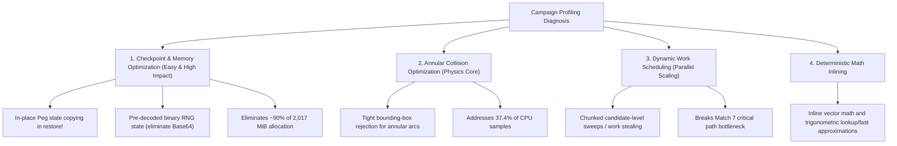

# Campaign Diagnostics: Profiling & Scaling Report

This report presents the diagnostic findings from the Phase 2 diagnostic run
[`20261025T121437Z_omarchy_e49038`](../../results/diagnostics/runs/20261025T121437Z_omarchy_e49038/README.md),
governed by protocol `campaign-diagnostics/1`.
The run analyzes the computational profile, heap allocations, memory evolution,
and instrumentation overhead of the primary **Ribbon 1v1 Campaign** workload.

An interactive notebook with pre-rendered charts and detailed visual breakdowns
accompanies this report at
[`notebooks/campaign_diagnostics.ipynb`](../../notebooks/campaign_diagnostics.ipynb).

---

## 1. Workload, Host & Provenance

The benchmark workload evaluates the 133-peg `ribbon_waves` level across eight
seeded shared-board 1v1 matches (79 total turns, evaluating **142,279 candidates**
at 1,801 aim indices per decision).

- **Protocol:** `campaign-diagnostics/1`
- **Host:** AMD Ryzen 5 4600H (6 physical cores, 12 logical CPUs, SMT enabled),
  Omarchy Linux (x86-64), Julia 1.12.6
- **Thread Budget:** 8 default simulation threads, 0 interactive threads, 1 GC thread
  (`-t 8,0 --gcthreads=1`)
- **Published Gameplay SHA-256:**
  `34f5319d5a5bcfaec6a190178495c1fae33fa94088339156bdb6ced6c9b92503`
- **Validation:** All 24 timing trials, both profiler campaigns, and all full warmups
  produced identical gameplay matching the published hash. Pre- and post-collection
  source stability and frozen reference checks passed. All compressed raw archive
  members were read back and checksum-verified.

---

## 2. Worker Scaling & Throughput Performance

Each worker count (1, 2, 4, 8) was executed in a fresh Julia process across three
paired repetitions alternating phase instrumentation enabled (`True`) and
disabled (`False`).

### Summary Scaling Table (Uninstrumented Variant)

Values below represent medians across the three uninstrumented (`phase_instrumentation=false`)
trials. Candidates per second evaluates total candidate shots completed over end-to-end wall time.

| Workers | Campaign Wall (s) | Min, Max Spread (s) | Candidates / s | Speedup | Parallel Efficiency |
| ---: | ---: | ---: | ---: | ---: | ---: |
| 1 | 149.514 | [146.920, 149.873] | 951.6 | 1.00× | 100.0% |
| 2 | 80.788 | [80.663, 81.471] | 1,761.1 | 1.85× | 92.6% |
| 4 | 45.648 | [45.522, 46.835] | 3,116.9 | 3.28× | 81.9% |
| 8 | 34.422 | [34.328, 37.737] | 4,133.4 | 4.34× | 54.3% |

Setup and simulation accounts for >99.98% of total wall time; JSON verification
and output serialization takes only 0.018–0.020 seconds across all trials.

---

## 3. Phase Instrumentation Overhead

Phase timers measure candidate reset, selection, simulation, actual shot execution,
and checkpoint preparation. Because fine-grained timers can perturb CPU instruction
caches and syscall overhead, `run_campaign` provides `phase_instrumentation=false`,
which specializes away candidate and phase clocks at compile time.

Paired overhead is calculated for each repetition as:
$$\text{Overhead} = \frac{t_{\text{enabled}} - t_{\text{disabled}}}{t_{\text{disabled}}} \times 100\%$$

| Workers | Median Overhead | Paired Range [Min, Max] | Interpretation |
| ---: | ---: | ---: | --- |
| 1 | +0.216% | [-1.026%, +1.026%] | Dominated by run-to-run noise; negligible overhead |
| 2 | +0.473% | [-1.244%, +1.389%] | Noise boundary; no statistically meaningful cost |
| 4 | +1.294% | [-2.435%, +2.525%] | Within ±2.5% desktop variance |
| 8 | +2.478% | [+1.076%, +3.068%] | Consistently positive; ~2.5% timer cost on short trials |

At 1–4 workers, timer overhead is well within the ambient desktop noise envelope.
At 8 workers, where campaign trials complete in ~35 seconds, timer calls impose a
mild (~2.5%) measurable penalty.

---

## 4. CPU Profile Breakdown & Execution Bottlenecks

A dedicated one-worker campaign was profiled using Julia's native `Profile`
sampler (10 ms interval, 10,000,000 buffer entries), collecting **13,813 primary-thread
samples** across the complete eight-match campaign without buffer overflow.

### Exclusive Stack Category Attribution

Categories are assigned using leaf-first stack classification (the deepest recognized
kernel owns the sample):

| Category | Samples | % of CPU | Primary Operations & Components |
| --- | ---: | ---: | --- |
| **Precise Collision & Physics** | 5,982 | **43.31%** | Narrow-phase intersections, integration, resolution (`physics.jl`, `impact_geometry.jl`) |
| **Broad-Phase Filtering** | 2,756 | **19.95%** | Annular and circular candidate culling (`broad_phase_pass`, `broad_phase_common`) |
| **Scoring & Events** | 2,586 | **18.72%** | Event pipeline, style bonus tracking (`style_shots_process!`, `reduce_peg_contacts!`) |
| **Engine Updates** | 2,446 | **17.71%** | Body stepping, bucket motion, peg bookkeeping (`engine.jl`, `ball_state.jl`) |
| **Garbage Collection (GC)** | 23 | **0.17%** | Stop-the-world allocation pause frames (`gc_collect`, `gc_mark`) |
| **Runtime / System Libs** | 19 | **0.14%** | C runtime, dynamic dispatch, OS loader |
| **Campaign & Reset** | 1 | **0.01%** | Orchestration, match iteration |

### Critical Finding: The Physics Myth

In prior baseline measurements, "Simulation" appeared as a single monolithic block
accounting for 98.8% of phase time. The CPU profile conclusively disproves the
assumption that broad-phase filtering is the dominant simulation bottleneck:
- **Broad-phase filtering represents only ~20.0%** of total CPU samples.
- **Narrow-phase collision and physics takes 43.3%** of CPU samples.
- **Scoring, events, and engine updates consume another 36.4%** combined.

Even an infinitely fast broad-phase filter could only reduce campaign execution time
by at most 20%.

### Top PeggleSim Hotspot Functions

Analyzing stack trace participation across all 13,813 samples highlights specific
computational hotspots:

| Function | Samples Present | % Samples | Module / Role |
| --- | ---: | ---: | --- |
| `physics_update!` | 8,749 | 63.34% | Main simulation physics step |
| `check_annulars` | 5,167 | 37.41% | Curved/annular peg narrow-phase collision |
| `broad_phase_pass` | 2,754 | 19.94% | Broad-phase spatial candidate checking |
| `style_shots_process!` | 2,234 | 16.17% | Style shot detection and point assignment |
| `broad_phase_common` | 2,080 | 15.06% | Bounding circle/box intersection tests |
| `depenetrate` | 1,620 | 11.73% | Ball-peg overlap resolution and impulse correction |
| `annular_check_corner` | 1,358 | 9.83% | Precise arc endpoint intersection |
| `check_circles` | 1,303 | 9.43% | Standard circular peg collision check |
| `det_sqrt` | 1,288 | 9.32% | Deterministic square root |
| `det_cos` | 1,008 | 7.30% | Deterministic cosine |
| `reduce_peg_contacts!` | 880 | 6.37% | Peg contact tracking and hit deduction |
| `det_sin` | 700 | 5.07% | Deterministic sine |
| `det_atan2` | 634 | 4.59% | Deterministic arctangent |

Annular pegs alone (`check_annulars`, `annular_check_corner`, `annular_check_cap`)
account for over 37% of physics computation. Furthermore, deterministic math
calls (`det_sqrt`, `det_cos`, `det_sin`, `det_atan2`) appear in over 26% of stack
traces.

---

## 5. Allocation & Garbage Collection Profiling

In Milestone 4, individual shot simulations were qualified under a strict zero-allocation
criterion (0 bytes allocated across all 5 standard shot probes). However, the full
campaign diagnostic trial revealed that **a complete campaign allocates ~2,017 MiB**.

A separate one-worker profiling campaign using Julia's `Profile.Allocs` sampled
**132,009 allocation events** (at rate $p = 0.01$).

### Top Allocation Sites by Sampled Bytes

| Allocation Site | Location | Sampled Bytes | % Sampled | Description |
| --- | --- | ---: | ---: | --- |
| `Peg` struct instantiation | `level.jl:41` [inlined] | 16,475,200 | **76.73%** | Re-creating peg mutable structs during `restore!` |
| `restore!` Base64 decoding | `checkpoint.jl:872` | 2,911,228 | **13.56%** | `Base64.base64decode` parsing RNG string state |
| `FeverDivider` instantiation | `state.jl:46` [inlined] | 410,736 | 1.91% | Recreating bucket divider structs |
| `restore!` live ball dictionary | `checkpoint.jl:902` | 397,440 | 1.85% | Re-allocating `live_id_by_ball` hash table |
| `FeverBucketSpec` instantiation | `state.jl:40` [inlined] | 228,768 | 1.07% | Recreating bucket spec structs |
| `BallState` struct instantiation | `state.jl:88` [inlined] | 114,720 | 0.53% | Ball state creation |
| Runtime / System memory | `runtime_or_other` | 103,493 | 0.48% | Julia compiler and runtime memory |
| `MatchState` struct instantiation | `state.jl:296` [inlined] | 92,224 | 0.43% | Match state creation |
| `_match_from_checkpoint` | `checkpoint.jl:776` [inlined] | 91,136 | 0.42% | Match restoration from checkpoint |
| `MatchPlayer` struct instantiation | `state.jl:290` [inlined] | 88,896 | 0.41% | Player tracking state creation |

### Why Does the Campaign Allocate 2,017 MiB?

While a shot is zero-allocation once launched, the bot decision loop evaluates
1,801 candidate aim angles per turn. Before each candidate shot, the bot resets the
simulation state by calling `restore!(sim, ckpt)`.
As written:
1. `restore!` iterates over pegs and pushes **newly allocated `Peg` structs** into
   `e.pegs` (`level.jl:41`).
2. `restore!` calls `Base64.base64decode` to restore the RNG state from a base64
   string (`checkpoint.jl:872`), creating temporary byte arrays and strings.

Evaluating 142,279 candidates multiplies these small allocations into ~2 GB of
garbage.

### GC Impact

- Total GC collections: **104–128 collections** per campaign.
- Total GC pause duration: **0.23 s** at 1 worker, rising to **0.41 s** at 8 workers.
- GC pause fraction: **0.16%** of wall time at 1 worker; **1.19%** at 8 workers.

Because Julia GC pause time is only ~1% of wall time, GC pauses alone are not
choking throughput. However, allocating and freeing 2 GB causes continuous cache
evictions and memory bus traffic.

---

## 6. Process Memory Footprint (RSS Evolution)

Resident Set Size (RSS) was recorded across key lifecycle stages for each worker count.
The Python parent process sampled `/proc/[pid]/statm` externally every 100 ms.

| Workers | Loaded RSS (MiB) | Warmed RSS (MiB) | Post-Campaign RSS (MiB) | Sampled Peak (MiB) | Lifetime Peak (MiB) |
| ---: | ---: | ---: | ---: | ---: | ---: |
| 1 | 598.8 | 611.8 | 611.5 | 654.8 | 654.6 |
| 2 | 594.3 | 640.4 | 666.2 | 710.7 | 710.6 |
| 4 | 603.7 | 629.5 | 662.3 | 708.7 | 734.0 |
| 8 | 601.2 | 672.3 | 683.3 | 731.8 | 731.3 |

- **Loaded RSS (~600 MiB):** Represents base Julia runtime, loaded packages, JIT engine,
  and interchange data structures.
- **Incremental Worker Memory:** Additional RSS per worker is small (approx.
  15–20 MiB per active worker thread).
- **Peak RSS (~734 MiB):** Occurs during JIT warmups; post-campaign memory drops back
  to ~683 MiB without explicit forced collection.

---

## 7. Workload Imbalance & The 8-Worker Scaling Plateau

Parallel speedup scales smoothly from 1 to 4 workers (3.28× speedup, 81.9% efficiency),
but plateaus from 4 to 8 workers (4.34× speedup, 54.3% efficiency).
The cause is **coarse match-level task scheduling combined with variable match duration**.

The campaign schedules one Julia task per match (8 tasks across 8 workers). Because
matches terminate dynamically upon red peg clearance or ball exhaustion, match lengths
vary dramatically:

| Match | Winner | Turns | Candidates | Simulation Wall Time (s) | Relative Work |
| ---: | --- | ---: | ---: | ---: | ---: |
| 1 | Player 2 | 7 | 12,607 | 20.36 s | 13.9% |
| 2 | Player 1 | 10 | 18,010 | 19.66 s | 13.5% |
| 3 | Player 2 | 8 | 14,408 | 14.22 s | 9.7% |
| 4 | Player 1 | 9 | 16,209 | 15.92 s | 10.9% |
| 5 | Player 2 | 6 | 10,806 | 12.50 s | 8.6% |
| 6 | Player 1 | 11 | 19,811 | 18.34 s | 12.6% |
| **7** | **Player 1** | **20** | **36,020** | **26.37 s** | **18.1% (Critical Path)** |
| 8 | Player 2 | 8 | 14,408 | 19.04 s | 13.0% |

- **Match 7 is the critical path:** Lasting 20 turns and evaluating 36,020 candidates,
  Match 7 takes **26.37 seconds** of simulation time.
- **Match 5 completes in 12.50 seconds:** The worker executing Match 5 finishes in
  under half the time and sits idle for ~14 seconds waiting for Match 7 to complete.

Under Amdahl's Law, the maximum theoretical speedup for an 8-match batch scheduled
with 1 match per worker is:
$$\text{Speedup}_{\text{max}} \approx \frac{\sum T_i}{\max(T_i)} = \frac{146.4\text{ s}}{26.4\text{ s}} \approx 5.55\times$$

The measured speedup of 4.34× (achieving 34.4s wall time against a theoretical minimum
of ~26.4s) indicates that core hardware utilization is near the theoretical limit of
match-level scheduling. Higher scaling will require candidate-level parallelism or
work-stealing.

---

## 8. Strategic Optimization Roadmap

Based on the quantitative profile, optimizations should be prioritized in the following
order:

### 1. In-Place Peg Copying & Binary RNG State (Highest Return)
- **Target:** `Peg` allocations at `level.jl:41` and `base64decode` at `checkpoint.jl:872`.
- **Action:** Instead of calling `push!(e.pegs, Peg(...))` in `restore!`, mutate existing
  allocated `Peg` fields in place. Store checkpoint RNG state as raw binary integers
  rather than Base64 strings.
- **Expected Impact:** Reduces campaign allocations from **2,017 MiB to <100 MiB**,
  drastically improving CPU L1/L2 cache residency and reducing GC pressure.

### 2. Annular Narrow-Phase Collision Pruning
- **Target:** `check_annulars` (37.41% of CPU samples) and `annular_check_corner` (9.83%).
- **Action:** Introduce an oriented bounding box or multi-stage radial sector test
  prior to evaluating expensive corner and arc trigonometric projections.

### 3. Candidate-Level Parallelism or Work Stealing
- **Target:** Match 7 critical path bottleneck.
- **Action:** Parallelize candidate evaluation within turns across available workers,
  or implement work-stealing so idle workers can evaluate candidates for active matches.
- **Expected Impact:** Allows 8 workers to break the ~5.5× Amdahl limit and approach
  linear 7.0–7.5× speedup.

### 4. Style Shot Processing Bypass
- **Target:** `style_shots_process!` (16.17% of CPU samples).
- **Action:** During bot candidate evaluations, style shots do not affect gross shot
  selection. Provide a stripped evaluation path that omits style tracking.

---

## 9. Artifacts & Reference

- **Interactive Jupyter Notebook:**
  [`notebooks/campaign_diagnostics.ipynb`](../../notebooks/campaign_diagnostics.ipynb)
- **Run Directory:**
  [`results/diagnostics/runs/20261025T121437Z_omarchy_e49038/`](../../results/diagnostics/runs/20261025T121437Z_omarchy_e49038/)
- **Diagnostics Protocol Specification:**
  [`wiki/context/campaign-diagnostics.md`](../context/campaign-diagnostics.md)
- **Compressed Raw Artifact Archive:**
  `results/diagnostics/artifacts/20261025T121437Z_omarchy_e49038.tar.gz`
- **Audit Script:**
  `python3 scripts/audit_campaign.py results/campaign/1v1/baseline.json`
