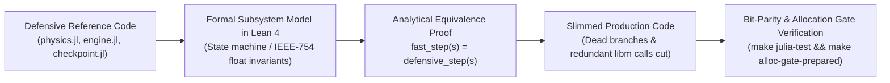
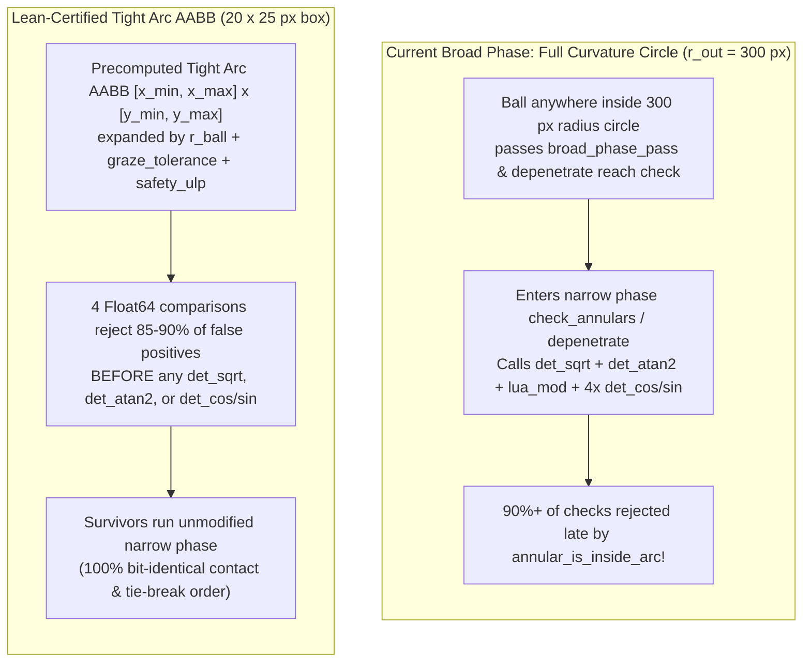

# Proof-Driven Performance Optimization & Formal Verification with Lean 4

**Related documents:**
- [Optimization Strategy: Memory, Parallelism & Cost](file:///home/kurapica/Projects/pevo/julia_clone/wiki/context/optimization-strategy.md)
- [Campaign Diagnostics: Profiling & Scaling Report](file:///home/kurapica/Projects/pevo/julia_clone/wiki/benchmarks/campaign-diagnostics.md)
- [Prepared Checkpoints & Compact Geometry](file:///home/kurapica/Projects/pevo/julia_clone/wiki/context/prepared-checkpoint.md) · [Deathstar Benchmark](file:///home/kurapica/Projects/pevo/julia_clone/wiki/benchmarks/prepared-checkpoint.md)
- [ADR-0001: Math Backend for the Authoritative Path](file:///home/kurapica/Projects/pevo/julia_clone/wiki/decisions/0001-math-backend.md)
- [Mathematical Evaluation Model](file:///home/kurapica/Projects/pevo/julia_clone/wiki/brainstorming/mathematical_evaluation_model.md) · [Stochastic Processes & Inverse Generation](file:///home/kurapica/Projects/pevo/julia_clone/wiki/brainstorming/stochastic_processes_and_inverse_generation.md)

---

## 1. Executive Summary & Core Thesis

In an empirical port governed by a strict bit-parity contract (matching LuaJIT + LÖVE 11.5 across 80,000+ checks and full campaign histories), **defensive code and redundant calculations accumulate naturally**. Whenever there is any doubt about whether a quantity might change mid-frame, whether an ID might collide, or whether a tighter geometric filter might miss a grazing contact 40 turns into a match, the developer must choose the conservative, unoptimized path.

**Lean 4** offers a way out of this empirical trap through **Proof-Driven Specialization (Invariant-Based Dead-Code & Math Elimination)**:
- Instead of guessing whether an optimization preserves bit parity on unseen levels, we model the relevant state transitions or geometric predicates in Lean 4 and **prove analytically** that the optimized fast path is observationally equivalent (`bisimilar` / bit-identical) to the defensive reference path.
- **Crucial Distinction — Where Lean Is Needed vs. Where It Isn't:**
  - **No Lean needed (ship immediately):** Purely local, referentially transparent cleanups (e.g., guarding unused `det_cos`/`det_sin` calls on capless ribbon pieces, passing already-computed trig into helpers, or merging a duplicate linear scan in `remove_peg!`) can be applied directly and verified with `make julia-test` and `make alloc-gate-prepared`.
  - **Lean earns its keep (global & geometric invariants):** Empirical tests only cover the **6 real levels** (`b1`, `b2`, `g1`, `m1`, `m2`, `ribbon_waves`). They cannot rule out a 1-in-100,000 geometric or floating-point edge case on future procedurally generated levels (e.g., a tight arc AABB missing a wrapped/grazing contact, or `owner + (part - owner)` ULP residuals). Lean certifies that these high-reward optimizations hold for **all** inputs and reachable states.
- **Not all defensive code is worth optimizing:** Empirical profiling from [`campaign-diagnostics.md`](file:///home/kurapica/Projects/pevo/julia_clone/wiki/benchmarks/campaign-diagnostics.md) demonstrates that micro-optimizations like `@inbounds` or reset-bookkeeping cleanup yield marginal gains ($<1\text{--}3\%$), whereas **eliminating dead/repeated `libm` calls and false-positive narrow-phase annular checks** targets **$\sim 50\text{--}60\%$ of total CPU samples**, unlocking a realistic best-case **+35% to +60% throughput speedup ($\sim 1.35\times\text{--}1.60\times$)** in pure Julia (and directly back-portable to Lua in `../peggle_evolved`).



---

## 2. Why Micro-Optimizations (`@inbounds`) Yield Marginal Gains ($< 1\%$)

Before estimating what Lean-backed optimizations can achieve, we must understand why sprinkling `@inbounds` across [`PeggleSim`](file:///home/kurapica/Projects/pevo/julia_clone/julia/PeggleSim/src/PeggleSim.jl) produces negligible throughput improvements:

1. **Hardware Branch Prediction Hides Bounds Checks in Non-Vectorized Loops:**
   On modern out-of-order x86-64 microarchitectures (AMD Ryzen 5 4600H `znver2` and Deathstar `znver1`), an in-bounds array check (`0 <= i < length`) inside a loop that executes 50–200 cycles of work per iteration is predicted with $>99.9\%$ accuracy by the CPU branch predictor and speculated past at nearly **zero net cycle cost**.
2. **`@inbounds` Only Delivers Large Speedups When It Unlocks SIMD Auto-Vectorization:**
   In Julia/LLVM, removing bounds checks matters primarily when the check is the sole side-effect preventing the loop vectorizer from packing 4× `Float64` lanes into AVX2 `ymm` registers.
3. **Why LLVM Cannot Auto-Vectorize `PeggleSim`'s Inner Loops:**
   - **Strict IEEE-754 Parity ([`ADR-0001`](file:///home/kurapica/Projects/pevo/julia_clone/wiki/decisions/0001-math-backend.md)):** The authoritative path forbids `@fastmath`, `@simd`, and fused multiply-add (`fma`/`muladd`) so that expression rounding matches LuaJIT bit-for-bit.
   - **Opaque C Calls (`ccall` into `libm.so.6`):** In [`detmath.jl`](file:///home/kurapica/Projects/pevo/julia_clone/julia/PeggleSim/src/detmath.jl), `det_sqrt`, `det_cos`, `det_sin`, and `det_atan2` execute `ccall`s into external shared libraries (`libm.so.6` or `libpeggle_math.so`). To LLVM's loop vectorizer, an external `ccall` is an opaque barrier with unknown side effects.

> [!IMPORTANT]
> **The Fundamental Performance Law of `PeggleSim`:**
> Because inner loops are bound by external `libm` calls (which appear in **$>26\%$ of all CPU samples**) and branchy narrow-phase collision tests (**$43.3\%$ of all CPU samples**), throughput only increases substantially when we **reduce the number of `libm` calls, narrow-phase entries, and per-frame array reconstructions**—not when we elide bounds checks.

---

## 3. Quantitative Opportunity Map: Three Tiers of Proof-Backed Optimization

Using the 13,813-sample CPU profile and 132,009-sample allocation profile from [`campaign-diagnostics.md`](file:///home/kurapica/Projects/pevo/julia_clone/wiki/benchmarks/campaign-diagnostics.md#L86-L165) (plus the Oct 27 `StaticCollisionQuery` and Oct 28 `PreparedCheckpoint` experiments in [`optimization-strategy.md` §13](file:///home/kurapica/Projects/pevo/julia_clone/wiki/context/optimization-strategy.md#L491-L648)), we classify proof-backed optimizations into three tiers by their **Amdahl's Law CPU ceiling**:

| Tier | Target Subsystem & Files | What Lean Proves Redundant / Sound | CPU Share Addressed | Realistic Throughput Gain |
| :--- | :--- | :--- | :---: | :---: |
| **Tier A**<br/>*Reset & Bookkeeping Specialization* | [`checkpoint.jl`](file:///home/kurapica/Projects/pevo/julia_clone/julia/PeggleSim/src/checkpoint.jl)<br/>[`engine.jl`](file:///home/kurapica/Projects/pevo/julia_clone/julia/PeggleSim/src/engine.jl) | 19 empty-dict copies in `_restore_trackers!`, `1,168 B` `MatchState` reset alloc, triple ball-ID map & scan in `register_ball!`, double peg-delete scan in `remove_peg!` | **$\sim 1.5\text{--}3\%$** | **+1% to +3%**<br/>*(1.01× – 1.03×; achieves strict 0 B reset alloc)* |
| **Tier B**<br/>*Dead & Loop-Invariant Trig Elimination* | [`physics.jl`](file:///home/kurapica/Projects/pevo/julia_clone/julia/PeggleSim/src/physics.jl)<br/>[`engine.jl`](file:///home/kurapica/Projects/pevo/julia_clone/julia/PeggleSim/src/engine.jl) | 4 dead `det_cos`/`det_sin` calls on capless ribbon pieces, up to 20× repeated trig in `annular_check_cap`/`corner`, per-frame `ribbon_collision_pieces!` refresh on static boards | **$\sim 12\text{--}18\%$**<br/>*(`det_cos` + `det_sin` = **12.37%** of all CPU samples)* | **+12% to +20%**<br/>*(1.12× – 1.20×)* |
| **Tier C**<br/>*Certified Tight Arc AABB Culling* | [`physics.jl`](file:///home/kurapica/Projects/pevo/julia_clone/julia/PeggleSim/src/physics.jl)<br/>[`checkpoint.jl`](file:///home/kurapica/Projects/pevo/julia_clone/julia/PeggleSim/src/checkpoint.jl) | Zero-false-negative soundness of precomputed tight arc AABBs replacing full curvature-radius `r_out` circles in `check_annulars` and `depenetrate` | **$\sim 49\%$**<br/>*(`check_annulars` **37.41%** + `depenetrate` **11.73%**)* | **+20% to +35%**<br/>*(1.20× – 1.35×)* |
| **Combined**<br/>*(Tiers A + B + C)* | Pure Julia algorithmic & invariant pruning | All of the above, preserving 100% bit parity | **$\sim 55\text{--}65\%$** | **+35% to +60%**<br/>*($\sim 1.35\times\text{--}1.60\times$ faster; $-26\%$ to $-38\%$ wall time)* |

> [!TIP]
> **Historical Calibration:**
> Why is a $+35\%\text{--}60\%$ combined gain realistic? On 27 October 2026 ([`optimization-strategy.md` §13.2](file:///home/kurapica/Projects/pevo/julia_clone/wiki/context/optimization-strategy.md#L520-L540)), hoisting a single repeated `DetMath.det_sqrt` call out of `broad_phase_common` into `StaticCollisionQuery` (which accounted for **7.59%** of CPU samples) reduced 10-match campaign wall time on Deathstar from **180.03 s to 145.95 s ($-18.93\%$ time, $+23.35\%$ throughput)** with byte-identical histories. Tiers B and C target a combined **$>45\%$** of CPU samples using the exact same principle.

---

## 4. Deep Dive: Concrete Code Hotspots & Their Lean 4 Proofs

### 4.1 Tier B.1 — Eliminating Dead & 20× Repeated Trig in `check_annulars`

**The Code Today ([`physics.jl:1108-1142`](file:///home/kurapica/Projects/pevo/julia_clone/julia/PeggleSim/src/physics.jl#L1108-L1142) and [`physics.jl:330-397`](file:///home/kurapica/Projects/pevo/julia_clone/julia/PeggleSim/src/physics.jl#L330-L397)):**
Every time an annular peg or ribbon collision piece survives `broad_phase_pass`, [`check_annulars`](file:///home/kurapica/Projects/pevo/julia_clone/julia/PeggleSim/src/physics.jl#L1108-L1142) executes:

```julia
# 3. Caps (normals derived from the slice-start arc angles)
cos_ts = DetMath.det_cos(t_start)
sin_ts = DetMath.det_sin(t_start)
cos_te = DetMath.det_cos(t_end)
sin_te = DetMath.det_sin(t_end)

# Ribbon pieces suppress their internal (shared) caps.
if !peg.no_cap_start
    annular_check_cap(ctx, peg, ball, i, t_offset, t_scale, px, py, bx,
                      by, dx, dy, slice_move_x, slice_move_y, sin_ts,
                      -cos_ts, t_start)
end
if !peg.no_cap_end
    annular_check_cap(ctx, peg, ball, i, t_offset, t_scale, px, py, bx,
                      by, dx, dy, slice_move_x, slice_move_y, -sin_te,
                      cos_te, t_end)
end

# 4. Corners (recomputed at the slice-start transform)
if !peg.no_cap_start
    annular_check_corner(ctx, peg, ball, i, t_offset, t_scale, px, py,
                         bx, by, dx, dy, slice_move_x, slice_move_y,
                         a, shape.r_in, t_start)
    annular_check_corner(ctx, peg, ball, i, t_offset, t_scale, px, py,
                         bx, by, dx, dy, slice_move_x, slice_move_y,
                         a, shape.r_out, t_start)
end
```

And inside [`annular_check_cap`](file:///home/kurapica/Projects/pevo/julia_clone/julia/PeggleSim/src/physics.jl#L333-L371) and [`annular_check_corner`](file:///home/kurapica/Projects/pevo/julia_clone/julia/PeggleSim/src/physics.jl#L395-L396):
```julia
# Inside annular_check_cap (lines 333-334, 346-347, 370-371):
cap_px = px + shape.r_in * DetMath.det_cos(angle)
cap_py = py + shape.r_in * DetMath.det_sin(angle)
...
cap_dir_x = DetMath.det_cos(angle)
cap_dir_y = DetMath.det_sin(angle)

# Inside annular_check_corner (lines 395-396):
iter_corner_x = px + corner_r * DetMath.det_cos(corner_theta)
iter_corner_y = py + corner_r * DetMath.det_sin(corner_theta)
```

**Three Compounding Redundancies Identified:**
1. **Unconditional Dead `libm` Calls on Interior Ribbon Pieces:** For every interior piece of a ribbon (`peg.no_cap_start == true && peg.no_cap_end == true`), lines 1109–1112 call `det_cos` and `det_sin` **4 times**, and **never read `cos_ts`, `sin_ts`, `cos_te`, or `sin_te`** because all four `if !peg.no_cap_*` branches are skipped!
2. **Up to 20× Redundant Recomputations on Cap/Corner Pieces:** When `!peg.no_cap_start` or `!peg.no_cap_end` is true, even though `cos_ts = det_cos(t_start)` and `sin_ts = det_sin(t_start)` were already computed at lines 1109–1110, `annular_check_cap` and `annular_check_corner` call `det_cos` and `det_sin` on the **exact same `t_start` and `t_end` angles up to 20 additional times** per peg per slice!
3. **Static Angle Invariance Across the Entire Match:** On static levels (`peg_va == 0.0`), `slices == 1` and `t_offset == 0.0`, so inside [`check_annulars`](file:///home/kurapica/Projects/pevo/julia_clone/julia/PeggleSim/src/physics.jl#L975-L997):
   $$t_{\text{start}} = (\theta_{\text{start}} - 0.0 \cdot \Delta t) + 0.0 \cdot \Delta t \cdot 0.0 = \theta_{\text{start}}$$
   meaning `cos_ts`, `sin_ts`, `cos_te`, `sin_te`—and even the 4 corner offsets `r_in * cos_ts`, `r_out * cos_ts`, etc.—are **level-wide constants** that can be stored directly in `CompactPegGeometry{AnnularShape}`!

**The Lean 4 Theorem to Formalize:**
- **IEEE-754 Signed-Zero Angle Identity:** Prove that for any IEEE-754 `Float64` angle $\theta$ and $\Delta t \ge +0.0$, when $\omega = +0.0$ and $s = 0$, the IEEE-754 expression $(\theta - \omega \otimes \Delta t) \oplus (\omega \otimes \Delta t \otimes (+0.0))$ is bit-identical to $\theta$ (with the single standard IEEE-754 caveat that $(-0.0) - (+0.0) \oplus (+0.0) = +0.0$, where $\cos(-0.0) = \cos(+0.0) = 1.0$ and $\sin(\pm 0.0)$ is preserved if $\theta \ne -0.0$ or precomputed via the exact same `theta - 0.0` expression).
- **Pure Function Referential Transparency:** Because `DetMath.det_cos` and `DetMath.det_sin` are pure functions of a single `Float64` argument and the fixed `MATH_BACKEND`, passing `(cos_ts, sin_ts)` by value into `annular_check_cap` and `annular_check_corner` is bit-identical to calling `DetMath.det_cos(t_start)` inside each helper.

---

### 4.2 Tier B.2 — Unlocking `static_geometry = true` on the 5 Ribbon Real Levels

**The Code Today ([`engine.jl:307-308`](file:///home/kurapica/Projects/pevo/julia_clone/julia/PeggleSim/src/engine.jl#L307-L308) and [`physics.jl:1435-1517`](file:///home/kurapica/Projects/pevo/julia_clone/julia/PeggleSim/src/physics.jl#L1435-L1517)):**
Currently, [`reset_shot_engine!`](file:///home/kurapica/Projects/pevo/julia_clone/julia/PeggleSim/src/engine.jl#L307-L308) disables `static_geometry` whenever a level contains ribbons:
```julia
eng.static_geometry = ckpt isa PreparedCheckpoint && compact && static_geometry &&
                      !ckpt.has_ribbons
```
Because **5 of the 6 real levels (`b1`, `g1`, `m1`, `m2`, `ribbon_waves`) have ribbons**, only `b2` ever takes the `static_geometry` fast path ([`prepared-checkpoint.md`](file:///home/kurapica/Projects/pevo/julia_clone/wiki/context/prepared-checkpoint.md#L67-L68)). On the other 5 levels, *every single 60 Hz physics step* runs [`ribbon_collision_pieces!`](file:///home/kurapica/Projects/pevo/julia_clone/julia/PeggleSim/src/physics.jl#L1435-L1485) and [`refresh_geometry!(geometry.annulars, annular_pegs)`](file:///home/kurapica/Projects/pevo/julia_clone/julia/PeggleSim/src/physics.jl#L1515) because of two subtleties:
1. **ULP Secant Velocity ([`physics.jl:1452-1472`](file:///home/kurapica/Projects/pevo/julia_clone/julia/PeggleSim/src/physics.jl#L1452-L1472)):**
   ```julia
   angle = peg.angle - peg.va * dt
   ca, sa = DetMath.det_cos(angle), DetMath.det_sin(angle)
   ...
   sx = peg.x - peg.vx * dt + x * ca - y * sa
   sy = peg.y - peg.vy * dt + x * sa + y * ca
   ...
   piece.vx = (part.x - sx) / dt
   piece.vy = (part.y - sy) / dt
   ```
   Even when `peg` is completely stationary (`peg.vx = peg.vy = peg.va = 0.0`), `part.x` was computed at level load, and `(part.x - (peg.x + part.local_x * cos(0) - part.local_y * sin(0))) / dt` can produce a non-zero ULP residual (e.g., $\sim 10^{-14}$).
2. **1-to-Many Piece Expansion in `remove_peg!` ([`engine.jl:661-668`](file:///home/kurapica/Projects/pevo/julia_clone/julia/PeggleSim/src/engine.jl#L661-L668)):**
   In `eng.annular_pegs`, a `RibbonShape` peg is 1 element, whereas in `ctx.annular_pieces` and `geometry.annulars`, it expands to $K = \text{length}(\text{shape.parts})$ contiguous pieces.

**The Lean 4 Theorem to Formalize:**
1. **Step-Invariance of Static Ribbon Piece State:**
   In Lean, model `ribbon_collision_pieces!(pegs, dt)`. Prove that if a peg is static (`peg.vx = 0`, `peg.vy = 0`, `peg.va = 0`, and `(peg.x, peg.y, peg.angle)` are invariant across steps) and `dt = config.fixed_dt` is constant across fixed steps, then `(piece.x, piece.y, piece.vx, piece.vy, piece.va)`—including the exact IEEE-754 ULP secant residual `(part.x - sx) / dt`—is a **step-invariant function of `(peg, part, fixed_dt)`**.
2. **Block-Slice Deletion Bisimulation:**
   Prove that expanding `eng.annular_pegs` into `annular_pieces` once at `prepare_checkpoint` (with fixed `fixed_dt`) and deleting the contiguous slice of pieces belonging to `peg` upon `remove_peg!(eng, peg)` produces the **exact same sequence of `annular_pieces` and `geometry.annulars` at every step $t$** as calling `ribbon_collision_pieces!` and `refresh_geometry!` on every frame:
   $$\forall t,\quad \text{delete\_slice}(\text{expand}(L_0),\, \text{removed}_t) = \text{expand}(\text{delete\_peg}(L_0,\, \text{removed}_t))$$

---

### 4.3 Tier C — Certified Tight Arc Bounding Boxes (`check_annulars` & `depenetrate`)

**Why `check_annulars` (37.41%) and `depenetrate` (11.73%) Consume ~49% of the CPU:**
Look at how bounding radii are assigned to annular sectors and ribbon pieces in [`checkpoint.jl:173`](file:///home/kurapica/Projects/pevo/julia_clone/julia/PeggleSim/src/checkpoint.jl#L173) and [`physics.jl:1474`](file:///home/kurapica/Projects/pevo/julia_clone/julia/PeggleSim/src/physics.jl#L1474):
```julia
piece.bounding_radius = part.shape.r_out
```
When a ribbon or curved slide has a gentle curvature, its center of curvature `(part.x, part.y)` lies far away and its outer radius $r_{\text{out}}$ is **enormous** (often $150\text{--}500\text{ px}$), even though the arc segment itself $[\theta_{\text{start}}, \theta_{\text{end}}]$ is only $15\text{--}25\text{ px}$ long!



As documented in [`optimization-strategy.md` §13.3](file:///home/kurapica/Projects/pevo/julia_clone/wiki/context/optimization-strategy.md#L565-L575), replacing or pre-filtering the `r_out` circle with a tight arc AABB requires **zero false negatives** across all 5 narrow-phase sub-tests:
1. Discrete overlap (`dist_center < ball.radius + r_out && annular_is_inside_arc`)
2. Swept Outer Arc (`r_out + ball.radius + graze_tolerance`)
3. Swept Inner Arc (`r_in - ball.radius`)
4. Start/End Caps (`r_in^2 - annular_cap_epsilon` to `r_out^2 + annular_cap_epsilon`)
5. Four Corner Circles (`(r_in, theta_start)`, `(r_out, theta_start)`, `(r_in, theta_end)`, `(r_out, theta_end)` with radius `ball.radius + graze_tolerance`)

**The Lean 4 Theorem to Formalize:**
Let $\mathcal{S}(px, py, r_{\text{in}}, r_{\text{out}}, \theta_1, \theta_2)$ be the annular sector, and define its exact extrema over $\theta \in [\theta_1 - \delta_{\text{arc}}, \theta_2 + \delta_{\text{arc}}]$ (checking endpoints $\theta_1, \theta_2$ and any cardinal axis crossings $\theta \in \{0, \frac{\pi}{2}, \pi, \frac{3\pi}{2}\}$ inside the angular interval):
$$x_{\min} = px + \min_{\theta,\, r \in \{r_{\text{in}} - \varepsilon, r_{\text{out}} + \varepsilon\}} r \cos\theta, \qquad x_{\max} = px + \max_{\theta,\, r \in \{r_{\text{in}} - \varepsilon, r_{\text{out}} + \varepsilon\}} r \cos\theta$$
(and similarly for $y_{\min}, y_{\max}$), padded by $M = r_{\text{ball}} + \text{graze\_tolerance} + \varepsilon_{\text{ulp}}$.
We prove in Lean the **Zero-False-Negative Containment Theorem**:
$$\forall (\mathbf{b}_0, \mathbf{m}),\quad \text{SweptBallBox}(\mathbf{b}_0, \mathbf{m}) \cap \text{ArcAABB}(\mathcal{S}, M) = \emptyset \implies \neg \text{CanContactOrGraze}(\mathbf{b}_0, \mathbf{m}, \mathcal{S})$$
Because the tight AABB filter is placed strictly *before* the existing narrow-phase math without altering how survivors are evaluated or ordered, **any theorem proving zero false negatives automatically guarantees 100% bit-identical trajectories and tie-breaks!**

---

### 4.4 Tier A — Reset Specialization, Ball Registry & Single-Scan Peg Removal

While Tier A targets a smaller slice of total CPU time ($\sim 1.5\text{--}3\%$), formalizing its state invariants eliminates the remaining **1,168 bytes/candidate reset allocation** ([`prepared-checkpoint.md`](file:///home/kurapica/Projects/pevo/julia_clone/wiki/context/prepared-checkpoint.md#L70-L72)) and cuts ~90 lines of defensive bookkeeping:

1. **Ready-to-Aim Empty Tracker & In-Place Match Restore ([`checkpoint.jl:951-996, 1150`](file:///home/kurapica/Projects/pevo/julia_clone/julia/PeggleSim/src/checkpoint.jl#L951-L996)):**
   - *Current defensive code:* `_restore_trackers!` resets all tracker containers and then runs 19 `copy!` / nested loop passes over `ckpt.trackers`; line 1150 allocates a new `MatchState` and `Vector{MatchPlayer}` via `_match_from_checkpoint(ckpt)` on every candidate reset.
   - *Lean Invariant:* At any `"ready_to_aim"` checkpoint boundary, `ckpt.trackers` has zero entries across all 19 maps and `ckpt.engine.turn_pegs_hit` is empty. Thus `reset_shot!` alone restores `sim.trackers`, and copying `MatchPlayer` fields in-place reduces candidate reset allocation to **0 bytes**.
2. **Monotone `next_ball_id` Invariant in `register_ball!` ([`engine.jl:380-427`](file:///home/kurapica/Projects/pevo/julia_clone/julia/PeggleSim/src/engine.jl#L380-L427)):**
   - *Current defensive code:* Maintains three structures (`used_ball_ids::Vector{Int}`, `live_ball_ids::Dict{Int,BallState}`, `live_id_by_ball::IdDict{BallState,Int}`) and loops `while candidate in e.used_ball_ids; candidate += 1; end` on every multiball spawn.
   - *Lean Invariant:* Prove by induction over `register_ball!` and `unregister_ball!` that $\forall id \in \text{used\_ball\_ids} \cup \text{dom}(\text{live\_ball\_ids}),\; id < \text{next\_ball\_id}$, and that a registered ball's `b.id` never mutates while live. Consequently, for auto-allocated balls (`b.id == 0`), `e.next_ball_id` is **guaranteed fresh** without scanning `used_ball_ids`, and `unregister_ball!` can read `b.id` directly without `live_id_by_ball`.
3. **Single-Scan Index Isomorphism in `remove_peg!` ([`engine.jl:656-677`](file:///home/kurapica/Projects/pevo/julia_clone/julia/PeggleSim/src/engine.jl#L656-L677)):**
   - *Current defensive code:* Scans `eng.circle_pegs` with `findfirst` to delete from `geometry.circles`, then calls `_remove_identity!(eng.circle_pegs, peg)` to scan `eng.circle_pegs` a second time.
   - *Lean Invariant:* `eng.circle_pegs` and `geometry.circles` have identical length and 1-to-1 ordinal alignment at every step, so finding index `i` once deletes from both vectors in a single pass.

---

## 5. Beyond Engine Speed: Lean in Evaluation & Inverse Generation

In addition to making [`PeggleSim`](file:///home/kurapica/Projects/pevo/julia_clone/julia/PeggleSim/src/PeggleSim.jl) slimmer and faster, the same Lean 4 workspace can formalize the core mathematical claims in our level-design models:

1. **Level Quality Index ($\text{LQI}$) Bottleneck Inequalities ([`mathematical_evaluation_model.md`](file:///home/kurapica/Projects/pevo/julia_clone/wiki/brainstorming/mathematical_evaluation_model.md#L187-L191)):**
   - Formalize the arithmetic-geometric hybrid $\text{LQI}(L) = \frac{1}{2}\sum_{p=1}^5 w_p Q_p + \frac{1}{2}\prod_{p=1}^5 \max(\epsilon, Q_p)^{w_p}$ and prove the **Single-Pillar Veto Ceiling**: any level with a collapsed pillar $Q_k \le \delta$ (e.g., 0 red pegs or $B_{\text{wg}} = 0$) is bounded above by $\frac{1}{2}(1 - w_k(1-\delta)) + \frac{1}{2}\max(\epsilon, \delta)^{w_k}$, proving that high $\text{LQI}$ requires balanced waveguide-scatterer geometry ($f_{\text{slide}} \in (0, 1)$).
2. **1v1 Tactical Regime-Switching Theorem ([`mathematical_evaluation_model.md` §2.3](file:///home/kurapica/Projects/pevo/julia_clone/wiki/brainstorming/mathematical_evaluation_model.md#L126-L131)):**
   - Prove that under the $-25\%$ red-miss penalty utility $U_{\text{1v1}}(a \mid B, \epsilon) = \mu_{\text{net}}(a) - (1 - p_{\text{red}}(a))\lfloor 0.25 B \rfloor$, optimal play switches from aggressive high-score shots to high-safety red-clearing shots at a unique banked-score threshold $B^*$ if and only if the upper Pareto frontier of $\{(p_{\text{red}}(a), \mu_{\text{net}}(a))\}$ has at least two vertices.
3. **Causal Swept-Tube Non-Interference for Inverse Level Generation ([`stochastic_processes_and_inverse_generation.md` §3.1](file:///home/kurapica/Projects/pevo/julia_clone/wiki/brainstorming/stochastic_processes_and_inverse_generation.md#L75-L86)):**
   - Prove that placing background scatterer pegs strictly outside the causal swept tubes $\bigcup_{m=1}^M \mathcal{F}^{(m)}$ of the Stage-1 "hero trajectories" leaves those hero trajectories 100% invariant under forward simulation—turning a PCG design heuristic into a certified geometric compiler pass.

---

## 6. Why Not Just Apply the Fixes Without Lean? (Triage & Roadmap)

A natural question is: *once we spot an inefficiency in the source code, why not simply edit Julia/Lua and run the test suite instead of writing a Lean proof?*

The answer splits cleanly into two categories:

1. **Local Refactorings (No Lean Needed):**
   If an optimization is purely syntactic or referentially transparent—like not calling `det_cos(t_start)` when `!peg.no_cap_start` is false, reusing an already-computed `cos_ts` instead of recomputing `det_cos(t_start)`, or deleting from two aligned arrays in one loop—you do **not** need a theorem prover. Standard code review plus `make julia-test` is sufficient.
2. **Global Invariants & Geometric Filters (Where Empirical Testing Breaks Down):**
   Your test suite only exercises **6 real levels** (`b1`, `b2`, `g1`, `m1`, `m2`, `ribbon_waves`). Passing `make julia-test` proves bit parity on those 6 boards, **not** on the 10,000th procedurally generated board. Lean is justified specifically where "looks right + passes 6 levels" can hide silent bugs:
   - **Silent false negatives in Tier C (Tight Arc AABB):** An arc bounding box has to handle wrapped angles ($\theta > 2\pi$ or $\theta < 0$), cardinal axis crossings, `graze_tolerance`, `annular_cap_epsilon`, `toi_epsilon`, discrete inner-hole overlap, and floating-point rounding. Missing one corner case passes all 6 test levels today and silently drops collisions on a future generated level.
   - **Deceptive IEEE-754 non-identities:** The codebase already documents places where standard algebra fails bit-parity (`owner + (part - owner)` not round-tripping in [`physics.jl:1431-1434`](file:///home/kurapica/Projects/pevo/julia_clone/julia/PeggleSim/src/physics.jl#L1431-L1434), `sincos` vs. separate `det_sin`/`det_cos`, and `-0.0` vs. `+0.0` in `static_query`).
   - **Inductive state invariants:** Proving that `ready_to_aim` tracker maps are always empty or `next_ball_id` is strictly monotone across *all* reachable sequences of turns, multiball spawns, and slide removals—not just the sequences exercised by the current campaign script.

### Recommended Implementation Roadmap

To capture the **+35% to +60% throughput gain** pragmatically without gating easy wins on formal proofs:

1. **Step 1 — Immediate Local Wins (No Lean Required):**
   - Guard the 4 `det_cos`/`det_sin` calls at [`physics.jl:1109-1112`](file:///home/kurapica/Projects/pevo/julia_clone/julia/PeggleSim/src/physics.jl#L1109-L1112) behind `!peg.no_cap_start` and `!peg.no_cap_end`, and pass `(cos_ts, sin_ts)` / `(cos_te, sin_te)` directly into `annular_check_cap` and `annular_check_corner` instead of recomputing them up to 20 times.
   - Apply single-scan `remove_peg!` ([`engine.jl:661-675`](file:///home/kurapica/Projects/pevo/julia_clone/julia/PeggleSim/src/engine.jl#L661-L675)) and in-place `MatchState` restore ([`checkpoint.jl:1150`](file:///home/kurapica/Projects/pevo/julia_clone/julia/PeggleSim/src/checkpoint.jl#L1150)).
   - Verify immediately with `make julia-test` and `make alloc-gate-prepared`.
2. **Step 2 — Lean-Certified Static Ribbon & Annular Precomputation (Tier B.2):**
   - Formalize the static ribbon ULP secant invariance (`ribbon_collision_pieces!`) and IEEE-754 signed-zero angle identity in `lean/`, then unlock `static_geometry = true` on all 6 real levels.
3. **Step 3 — Lean-Certified Tight Arc AABB (Tier C High-Impact Win):**
   - Prove the Zero-False-Negative Containment Theorem for 2D annular arc extrema in Lean 4, and add `(min_x, max_x, min_y, max_y)` to `CompactPegGeometry{AnnularShape}` to filter both `check_annulars` and `depenetrate`.
4. **Step 4 — Backport to Lua (`../peggle_evolved`):**
   - Port the dead-trig elimination and Lean-certified tight arc AABB pre-filter back to `../peggle_evolved/src/systems/physics.lua` and `src/entities/ribbon.lua`, accelerating the live LÖVE game with the same proven bit-parity guarantees.
