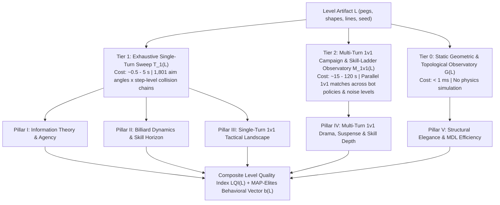

# Mathematical Evaluation Model for Peggle Evolved Levels

**Related documents:**
- [Literature Review & Theoretical Foundations](file:///home/kurapica/Projects/pevo/julia_clone/wiki/brainstorming/literature_review.md)
- [Archived Research Papers (`papers/`)](file:///home/kurapica/Projects/pevo/julia_clone/papers/README.md)
- [Prior Information Theory Notes](file:///home/kurapica/Projects/pevo/julia_clone/wiki/brainstorming/information_theory.md) · [Prior Level Design Notes](file:///home/kurapica/Projects/pevo/julia_clone/wiki/brainstorming/level_design.md)
- [Executable Julia Profiler (`scripts/profile_level.jl`)](file:///home/kurapica/Projects/pevo/julia_clone/scripts/profile_level.jl)
- [Measured Profiles JSON (`results/analysis/level_evaluation_profiles.json`)](file:///home/kurapica/Projects/pevo/julia_clone/results/analysis/level_evaluation_profiles.json)

---

## 1. Architecture of the Observatory: What Data Is Worth Collecting?

Because `PeggleSim` evaluates candidate shots at $\sim 25,000\text{--}50,000\text{ shots/sec}$ across 8 threads with zero steady-state allocations, we organize level telemetry into a **three-tier hierarchical observatory** $\mathcal{D}(L) = (\mathcal{G}(L), \mathcal{T}_1(L), \mathcal{M}_{\text{1v1}}(L))$. Each tier answers a distinct class of questions at a predictable computational cost:



### 1.1 Tier 0: Static Geometric & Topological Observatory $\mathcal{G}(L)$
Extracted directly from `level::LevelDefinition` in $O(N^2)$ time prior to simulation:
1. **Scatterer vs. Waveguide Composition**:
   - Total peg count $N$, color counts $(N_{\text{red}}, N_{\text{green}}, N_{\text{blue}})$, shape counts $(N_{\text{circle}}, N_{\text{rect}}, N_{\text{annular}})$.
   - Zero-gap slide peg count $N_{\text{slide}} = \sum_{i=1}^N \mathbb{I}(\text{peg}_i.\text{line} \ne \text{nothing} \land \text{peg}_i.\text{line.gap} == 0)$, distinct slide line count $L_{\text{lines}}$, and **Slide (Waveguide) Fraction** $f_{\text{slide}} = N_{\text{slide}} / N$.
2. **Spatial Dispersion & Symmetry**:
   - Nearest-Neighbor Distance (NND) vector $d_{\text{NN}}(i) = \min_{j \ne i} \|\mathbf{x}_i - \mathbf{x}_j\|_2$, mean $\bar{d}_{\text{NN}}$, and coefficient of variation $\text{CV}_{\text{NN}} = \sigma_{\text{NN}} / \bar{d}_{\text{NN}}$.
   - Mirror distance $d_{\text{mir}}(i) = \min_{j} \|(W - x_i, y_i) - (x_j, y_j)\|_2$ and **Horizontal Mirror Symmetry** $S_{\text{sym}} = \frac{1}{N} \sum_{i=1}^N \exp(-d_{\text{mir}}(i) / 25\text{ px}) \in [0, 1]$.
   - Normalized 2D grid occupancy entropy $H_{\text{spatial},2D} \in [0, 1]$ over an $8 \times 8$ partition of the frame $[0, W] \times [0, H]$.
3. **Generative Description Length Proxy $K_{\text{geom}}(L)$**:
   - Effective degrees of freedom $K_{\text{geom}}(L) = 6 L_{\text{lines}} + 2 (N - N_{\text{slide}})$, comparing raw coordinate complexity $2N$ against structured spline/primitive complexity.

### 1.2 Tier 1: Exhaustive Single-Turn Trajectory & Outcome Ensemble $\mathcal{T}_1(L)$
For every discrete aim index $\tilde{a} \in \mathcal{A} = \{0, 1, \dots, 1800\}$ ($|\mathcal{A}| = 1801$, spacing $\Delta \theta = 0.1^\circ$) from the ready-to-aim checkpoint, the profiler records:
1. **Ordered Scored-Peg Sequence**: $\tau(\tilde{a}) = (Y_1(\tilde{a}), Y_2(\tilde{a}), \dots, Y_{M(\tilde{a})}(\tilde{a})) \in \{1, \dots, N\}^{M(\tilde{a})}$, capturing the exact chronological sequence of pegs scored during the shot.
2. **Ordered Bounce-Collision Sequence**: $\beta(\tilde{a}) = (X_1(\tilde{a}), X_2(\tilde{a}), \dots, X_{K(\tilde{a})}(\tilde{a}))$, capturing every physical bounce (`did_bounce == true`) against pegs ($+1 \dots +N$), left/right/top walls ($-1, -2, -3$), and the bucket rim ($-4$).
3. **Score & Tactical Components**:
   - Gross score $S(\tilde{a}) = S_{\text{peg}}(\tilde{a}) + S_{\text{bonus}}(\tilde{a}) + S_{\text{style}}(\tilde{a})$.
   - Pegs hit $M(\tilde{a})$, red pegs hit $R(\tilde{a})$, binary red-clear gate $\mathbb{I}_{\text{red}}(\tilde{a}) = \mathbb{I}(R(\tilde{a}) > 0)$, green multiballs spawned $G(\tilde{a})$.
   - Style bitmask $\mathbf{y}_{\text{style}}(\tilde{a}) \in \{0, 1\}^6$ (`slide`, `long_shot`, `super_long_shot`, `double_long_shot`, `off_the_wall`, `lucky_bounce`) and per-style counts.
   - Terminal outcome: `bucket_caught` indicator $\mathbb{I}_{\text{bucket}}(\tilde{a})$, exit horizontal coordinate $x_{\text{exit}}(\tilde{a}) \in [0, W]$, simulation duration $T(\tilde{a})$ steps, mid-turn stall clearing indicator, and slide-inversion valley removals.

### 1.3 Tier 2: Multi-Turn 1v1 Campaign & Cross-Skill Tournament Observatory $\mathcal{M}_{\text{1v1}}(L)$
Across $M_{\text{base}}$ seeded shared-board 1v1 matches and $M_{\text{ladder}}$ side-swapped cross-skill matches, the profiler collects:
1. **Turn-by-Turn Match Trajectory**: Banked score pairs $(B_{1,t}, B_{2,t})_{t=0}^T$, active player $p_t \in \{1, 2\}$, red-hit indicator $\mathbb{I}_{\text{red},t}$, no-red penalty deducted $P_t = (1 - \mathbb{I}_{\text{red},t}) \lfloor 0.25 B_{p_t, t-1} \rfloor$, shared bucket catch counter, and cumulative distinct board pegs cleared.
2. **Termination & Winner Diagnostics**: Match length $T$, termination reason (`all_red_cleared` vs. `balls_exhausted` vs. `step_limit`/`turn_limit`), and winner $W \in \{1, 2, 0\}$.
3. **Cross-Skill Win Matrix**: Pairwise win rates (with swapped P1/P2 seats on identical seeds to eliminate first-mover bias) across four reference policies:
   - $\pi_{\text{tactical}}(\epsilon=1)$: Risk-aware 1v1 utility maximizer accounting for execution noise $\epsilon$ and the $-25\%$ red-miss penalty.
   - $\pi_{\text{sector}}(\epsilon=1)$: Baseline gross-score sector-median bot ([bot-campaign.md](file:///home/kurapica/Projects/pevo/julia_clone/wiki/context/bot-campaign.md)).
   - $\pi_{\text{sloppy}}(\epsilon=10)$: Low-precision sector-median bot with $10\times$ larger aiming jitter ($\pm 1.0^\circ$).
   - $\pi_{\text{random}}$: Uniform random aim bot.

---

## 2. The Five-Pillar Mathematical Evaluation Model

### Pillar I: Information Theory & Player Agency (Controllability & Empowerment)

#### 2.1 The Noisy Motor-Execution Channel
Let $A \in \mathcal{A} = \{0, \dots, 1800\}$ denote the player's **intended** aim index, and let $\tilde{A} \in \mathcal{A}$ denote the **executed** aim index after passing through a motor/input precision kernel $K_\sigma(\tilde{a} \mid a)$ of half-width $\sigma \in \mathbb{N}$ steps:
$$K_\sigma(\tilde{a} \mid a) = \frac{\mathbb{I}\big(\tilde{a} \in [\max(0, a-\sigma),\, \min(1800, a+\sigma)]\big)}{\min(1800, a+\sigma) - \max(0, a-\sigma) + 1}$$
Given a discrete outcome mapping $O: \mathcal{A} \to \mathcal{O}$ extracted from the deterministic simulation $\Phi_s(\tilde{a})$, the induced conditional outcome distribution for intended action $a$ is:
$$W_\sigma(o \mid a) = \sum_{\tilde{a} \in \mathcal{A}} K_\sigma(\tilde{a} \mid a)\, \mathbb{I}\big(O(\tilde{a}) = o\big)$$

We evaluate four complementary outcome spaces $\mathcal{O}$:
- **Macro-Route Bottleneck ($O_{\text{route}}$)**: Following the Information Bottleneck principle ([Tishby, Pereira, & Bialek 2000](file:///home/kurapica/Projects/pevo/julia_clone/papers/tishby_pereira_bialek_2000_information_bottleneck.pdf)), we compress each trajectory into a 5-tuple of macro-behavioral features:
  $$O_{\text{route}}(\tilde{a}) = \Big(\text{cell}_{4\times 4}(\bar{x}_{\text{hit}}, \bar{y}_{\text{hit}}),\; \min(5, \lfloor \log_2(1 + M(\tilde{a})) \rfloor),\; \text{exit\_quad}(\tilde{a}),\; \mathbb{I}_{\text{style}}(\tilde{a}),\; \mathbb{I}_{\text{red}}(\tilde{a})\Big)$$
  which has a bounded alphabet ($|\mathcal{O}_{\text{route}}| \lesssim 200$) that captures *where* the shot went, *how much* of the board it cleared, *where* it exited, and *what tactical effects* it achieved, without splintering on single-peg tail noise.
- **Exact Cleared Hit-Set ($O_{\text{hitset}}$)**: $\text{hash}(\text{sort}(\tau(\tilde{a})))$, measuring micro-trajectory uniqueness.
- **Score Tier ($O_{\text{score}}$)**: 16 quantile brackets of $S(\tilde{a})$.
- **1v1 Tactical Outcome ($O_{\text{tactical}}$)**: $(\mathbb{I}_{\text{red}}(\tilde{a}),\, \mathbb{I}_{\text{bucket}}(\tilde{a}),\, \mathbf{y}_{\text{style}}(\tilde{a}),\, \min(6, \lfloor M(\tilde{a})/3 \rfloor))$.

#### 2.2 Entropy, Mutual Information, Controllability, and Empowerment
Under a uniform action prior $p_{\text{unif}}(a) = 1/|\mathcal{A}|$ with marginal outcome distribution $P_\sigma(o) = \frac{1}{|\mathcal{A}|} \sum_a W_\sigma(o \mid a)$:

1. **Outcome Entropy (Behavioral Richness)**:
   $$H(O) = -\sum_{o \in \mathcal{O}} P_\sigma(o) \log_2 P_\sigma(o) \quad [\text{bits}]$$
2. **Noise Equivocation (Local Uncontrollable Chaos)**:
   $$H_\sigma(O \mid A) = \frac{1}{|\mathcal{A}|} \sum_{a \in \mathcal{A}} \left( -\sum_{o \in \mathcal{O}} W_\sigma(o \mid a) \log_2 W_\sigma(o \mid a) \right) \quad [\text{bits}]$$
3. **Mutual Information (Effective Player Agency)**:
   $$I_\sigma(A; O) = H(O) - H_\sigma(O \mid A) \quad [\text{bits}]$$
4. **Normalized Controllability Ratio**:
   $$\mathcal{C}_\sigma(O) = \frac{I_\sigma(A; O)}{H(O)} \in [0, 1]$$
5. **Empowerment (Blahut–Arimoto Channel Capacity)**:
   $$\mathfrak{E}_\sigma(O) = \max_{p(a) \in \Delta(\mathcal{A})} I_\sigma(A; O) \quad [\text{bits}]$$
   measuring the maximum information rate achievable when an expert player concentrates shots inside the level's stable basins ([Salge, Glackin, & Polani 2014](file:///home/kurapica/Projects/pevo/julia_clone/papers/salge_glackin_polani_2014_empowerment_introduction.pdf)).

---

### Pillar II: Dynamical Systems, Billiard Chaos & The Skill Horizon

#### 2.1 Collision-Indexed Mutual Information Decay
Along the chronological sequence of scored pegs $Y_1, Y_2, \dots, Y_k$ (and physical bounces $X_1, X_2, \dots, X_k$), the Data Processing Inequality governs the loss of control over time. At each hit index $k \in \{1, \dots, 15\}$:
$$I_\sigma(k) = I_\sigma(A; Y_k), \qquad \mathcal{C}_\sigma(k) = \frac{I_\sigma(A; Y_k)}{H(Y_k)}, \qquad \alpha(k) = \mathbb{P}\big(M(\tilde{A}) \ge k\big)$$
where $\alpha(k)$ is the **Active Cascade Survival Fraction** (the probability that a shot reaches at least $k$ scored pegs).

From this curve we define three fundamental dynamical invariants:
1. **Skill Horizon (Information Half-Life) $k_{1/2}$**:
   $$k_{1/2}(\sigma) = \inf \left\{ k \ge 1 : I_\sigma(A; Y_k) \le \frac{1}{2} I_\sigma(A; Y_1) \right\}$$
   interpolated continuously between integer steps.
2. **Integrated Trajectory Agency ($\text{AUC}_{\text{MI}}$)**:
   $$\text{AUC}_{\text{MI}}(\sigma) = \sum_{k=1}^{K_{\max}} I_\sigma(A; Y_k) \quad [\text{total bits of controlled peg interactions}]$$
   > [!TIP]
   > **Why $\text{AUC}_{\text{MI}}$ is the single most powerful discriminator of Peggle physics quality:**
   > A level can only achieve a high $\text{AUC}_{\text{MI}}$ (e.g. **61.57 bits** on `ribbon_waves`) if two conditions hold simultaneously:
   > 1. Shots trigger long, multi-peg cascades ($\alpha(k)$ stays high up to $k=15$), **AND**
   > 2. Those cascades remain systematically determined by the player's initial aim $A$ under motor noise $\sigma$ ($I_\sigma(A; Y_k)$ stays high rather than collapsing into white noise).
   > Short/sterile levels (`circle_level`: 13.79 bits; `squiggly_circle`: 13.39 bits) fail condition 1; purely chaotic pinball grids fail condition 2.
3. **Primary Coherent Shot Basins**:
   For adjacent aim indices $a, a+1$, define the **Primary-Prefix Jaccard Distance** over the first $k_p = 5$ scored pegs $P_5(a) = \{Y_1(a), \dots, Y_{\min(5, M(a))}(a)\}$:
   $$d_{J,5}(a, a+1) = 1 - \frac{|P_5(a) \cap P_5(a+1)|}{\max(1, |P_5(a) \cup P_5(a+1)|)} \in [0, 1]$$
   Maximal contiguous intervals $B_j = [a_{\text{start}}, a_{\text{end}}]$ with $M(a) > 0$ and $d_{J,5}(a, a+1) \le 0.40$ form **Primary Coherent Shot Basins** of width $w_j = |B_j|$. Basins with $w_j \ge 3$ steps survive $\epsilon = 1$ execution noise.

---

### Pillar III: Single-Turn Tactical & Expressive Landscape (1v1 Decision Richness)

On any turn state with active player banked score $B$, the 1v1 rules ([game-mechanics.md](file:///home/kurapica/Projects/pevo/peggle_evolved/wiki/game-mechanics.md)) induce for each intended aim $a \in \mathcal{A}$ under noise $\epsilon = 1$:
- **Red-Hit Safety Probability**: $p_{\text{red}}(a) = \sum_{\tilde{a}} K_1(\tilde{a} \mid a)\, \mathbb{I}_{\text{red}}(\tilde{a})$
- **Expected Banked Score (Turn 1)**: $\mu_{\text{net}}(a) = \sum_{\tilde{a}} K_1(\tilde{a} \mid a)\, \mathbb{I}_{\text{red}}(\tilde{a}) S(\tilde{a})$
- **State-Dependent 1v1 Expected Utility**:
  $$U_{\text{1v1}}(a \mid B, \epsilon) = \sum_{\tilde{a}} K_\epsilon(\tilde{a} \mid a) \Big[ \mathbb{I}_{\text{red}}(\tilde{a}) S(\tilde{a}) - \big(1 - \mathbb{I}_{\text{red}}(\tilde{a})\big) \lfloor 0.25 B \rfloor \Big]$$

From this landscape we compute:
1. **Effective Number of Competitive Sectors ($N_{\text{eff\_sectors}}$)**:
   Partitioning $\mathcal{A}$ into the $J=18$ standard sectors $S_1, \dots, S_{18}$ of width 100 ([bot-campaign.md](file:///home/kurapica/Projects/pevo/julia_clone/wiki/context/bot-campaign.md#L78)), let $v_j = \max_{a \in S_j} \mu_{\text{net}}(a)$ and $q_j = v_j / \sum_{l=1}^{18} v_l$. The **Sector Perplexity**:
   $$N_{\text{eff\_sectors}} = 2^{H(\mathbf{q})} = \exp_2\!\left( -\sum_{j=1}^{18} q_j \log_2 q_j \right) \in [0, 18]$$
   measures how many angular regions of the screen offer viable, competitive scoring opportunities.
2. **First-Contact Reachability Breadth ($N_{\text{first}}$)**:
   $$N_{\text{first}} = \big|\big\{ Y_1(\tilde{a}) : \tilde{a} \in \mathcal{A},\, M(\tilde{a}) > 0 \big\}\big|$$
   The number of distinct pegs directly reachable as the *first* scored impact of a shot. Low $N_{\text{first}}$ (e.g. `mustache` with $N_{\text{first}} = 15$ out of 99 pegs) diagnoses **top-layer shielding**, where an upper barrier blocks direct access to the interior of the level.
3. **Style-Shot Salience ($r_{\text{style}}$)**:
   Fraction of the action space $\mathcal{A}$ that awards at least one style shot (`slide`, `long_shot`, `super_long_shot`, `double_long_shot`, `off_the_wall`, `lucky_bounce`).
4. **Peg Exposure Gini Coefficient ($G_{\text{peg}}$)**:
   Let $\pi_i = \frac{1}{|\mathcal{A}|} \sum_{\tilde{a}} \mathbb{I}(i \in \tau(\tilde{a}))$ be the hit frequency of peg $i \in \{1, \dots, N\}$. The Gini index:
   $$G_{\text{peg}} = \frac{\sum_{i=1}^N \sum_{j=1}^N |\pi_i - \pi_j|}{2 N \sum_{i=1}^N \pi_i} \in [0, 1]$$
   measures inequality of peg utilization ($G_{\text{peg}} \to 0$ means every peg on the board participates equitably across the aim spectrum; $G_{\text{peg}} \to 1$ means a few outer shield pegs absorb all hits while interior pegs sit unreachable).

---

### Pillar IV: Multi-Turn 1v1 Game Theory & Aesthetic Dynamics

To evaluate full 1v1 matches played on the level, let $(B_{1,t}, B_{2,t})_{t=0}^T$ be the banked score sequence of a match with winner $W \in \{1, 2, 0\}$. We calibrate a smooth win-probability belief process $p_t = \mathbb{P}(\text{P1 wins} \mid \mathcal{F}_t)$ via the logistic value function:
$$p_0 = 0.5, \qquad p_t = \frac{1}{1 + \exp\!\big(-(B_{1,t} - B_{2,t}) / S_{\text{scale}}\big)} \quad (1 \le t < T), \qquad p_T = \begin{cases} 1 & W = 1 \\ 0 & W = 2 \\ 0.5 & W = 0 \end{cases}$$
where $S_{\text{scale}} = \max\big(2500,\, 0.25 \cdot \text{median}_m(B_{1,T}^{(m)} + B_{2,T}^{(m)})\big)$ is the characteristic late-game score swing scale (matching the $25\%$ penalty magnitude).

1. **Suspense ($\mathcal{U}_{\text{suspense}}$)** — Ely, Frankel, & Kamenica (2015):
   $$\mathcal{U}_{\text{suspense}} = \mathbb{E}_m \left[ \sqrt{\frac{1}{T_m} \sum_{t=1}^{T_m} (p_t^{(m)} - p_{t-1}^{(m)})^2} \right]$$
2. **Surprise ($\mathcal{U}_{\text{surprise}}$)** — Ely, Frankel, & Kamenica (2015):
   $$\mathcal{U}_{\text{surprise}} = \mathbb{E}_m \left[ \frac{1}{T_m} \sum_{t=1}^{T_m} |p_t^{(m)} - p_{t-1}^{(m)}| \right]$$
3. **Drama & Comeback Potential ($\mathcal{D}_{\text{drama}}$)** — Browne & Maire (2010):
   - **Lead-Change Frequency** $\bar{L}_{\text{chg}}$: average number of strict leader flips between Player 1 and Player 2 per match.
   - **Comeback Win Rate** $R_{\text{cb}}$: fraction of decisive matches where the eventual winner trailed by $>5\%$ at some turn $t \ge 1$.
   - **Maximum Deficit Overcome**: $\bar{\delta}_{\text{cb}} = \mathbb{E}_m\big[\max_t (B_{\text{loser},t} - B_{\text{winner},t}) / \max(B_{\text{loser},t}, 1000)\big]$.
4. **First-Player Fairness ($\mathcal{B}_{\text{1v1}}$)**:
   $$\mathcal{B}_{\text{1v1}} = 1 - 2 \big| W_{\text{P1}} - 0.5 \big| \in [0, 1]$$
   where $W_{\text{P1}} = \frac{1}{M}\sum_{m=1}^M \big(\mathbb{I}(W^{(m)}=1) + \frac{1}{2}\mathbb{I}(W^{(m)}=0)\big)$.
5. **Pacing & Red-Clearance Completion ($P_{\text{pacing}}, R_{\text{comp}}$)**:
   - $R_{\text{comp}} = \mathbb{P}(\text{termination} == \text{all\_red\_cleared})$.
   - $P_{\text{pacing}} = \text{clamp}\big(1 - |\bar{T} - 10.5| / 9.5,\, 0,\, 1\big)$, peaking when a 1v1 match lasts $\sim 9\text{--}12$ total turns ($5\text{--}6$ turns per player)—long enough for multiplier escalation and comebacks, short enough to avoid 20-turn attrition wars.
6. **Skill Differentiation ($\mathcal{S}_{\text{skill}}$)**:
   - **Motor Skill Gradient**: $W(\pi_{\text{sector}}(\epsilon=1) \text{ vs. } \pi_{\text{sloppy}}(\epsilon=10)) \in [0.5, 1.0]$.
   - **Rationality Gradient**: $W(\pi_{\text{sector}}(\epsilon=1) \text{ vs. } \pi_{\text{random}}) \in [0.5, 1.0]$.

---

### Pillar V: Structural Elegance & MDL Behavioral Efficiency

1. **Waveguide-to-Scatterer Balance ($B_{\text{wg}}$)**:
   Grounded in chaotic billiard theory ([literature_review.md §2](file:///home/kurapica/Projects/pevo/julia_clone/wiki/brainstorming/literature_review.md#2-chaotic-billiards--galton-boards-physics-of-the-skill-horizon)), a level requires both dispersing circular pegs ($1 - f_{\text{slide}}$) for branching variety and focusing zero-gap slides ($f_{\text{slide}}$) for phase-space funneling:
   $$B_{\text{wg}} = 4 f_{\text{slide}} (1 - f_{\text{slide}}) \in [0, 1]$$
   which vanishes for pure Galton grids ($f_{\text{slide}} = 0$) and pure closed slide shells ($f_{\text{slide}} = 1$), and approaches $1.0$ for balanced hybrid architectures ($f_{\text{slide}} \in [0.4, 0.65]$).
2. **MDL Behavioral Efficiency ($\eta_{\text{MDL}}$)**:
   $$\eta_{\text{MDL}} = \frac{\text{AUC}_{\text{MI}}(\sigma=2)}{\log_2\big(1 + K_{\text{geom}}(L)\big)}$$
   measuring how many bits of controlled multi-bounce trajectory agency the level generates per bit of structural description length.

---

### Composite Level Quality Index ($\text{LQI}$)

Each pillar $p \in \{1, \dots, 5\}$ is normalized to a dimensionless score $Q_p \in [0, 1]$ (exact weights in [`scripts/profile_level.jl`](file:///home/kurapica/Projects/pevo/julia_clone/scripts/profile_level.jl#L951-L1016)). To ensure that a catastrophic failure in any single pillar (e.g., 0 red pegs in 1v1, or 0 skill horizon) cannot be masked by high scores elsewhere, we combine the weighted **Arithmetic Mean** and **Geometric Mean**:
$$\text{LQI}(L) = \frac{1}{2} \sum_{p=1}^5 w_p Q_p + \frac{1}{2} \prod_{p=1}^5 \big(\max(0.01, Q_p)\big)^{w_p}, \qquad \mathbf{w} = (0.22,\, 0.23,\, 0.20,\, 0.23,\, 0.12)$$

---

## 3. Empirical Validation: `ribbon_waves` vs. Comparison Corpus

We executed [`scripts/profile_level.jl`](file:///home/kurapica/Projects/pevo/julia_clone/scripts/profile_level.jl) across all five levels in the workspace. Complete raw outputs are archived in [`results/analysis/level_evaluation_profiles.json`](file:///home/kurapica/Projects/pevo/julia_clone/results/analysis/level_evaluation_profiles.json).

### 3.1 Executive Ranking & Pillar Breakdown

| Level | Category / Archetype | **Overall LQI** | **P1: Agency & Control** | **P2: Skill Horizon & Dynamics** | **P3: Tactical Landscape** | **P4: 1v1 Drama & Balance** | **P5: Structural Elegance** |
| :--- | :--- | :---: | :---: | :---: | :---: | :---: | :---: |
| **[`ribbon_waves`](file:///home/kurapica/Projects/pevo/peggle_evolved/src/levels/ribbon_waves.lua)** | **Enjoyable Reference** (5 curved slide ribbons + 53 circle scatterers) | **0.932** | **0.954** | **0.870** | **0.958** | **0.947** | **0.944** |
| **[`mustache`](file:///home/kurapica/Projects/pevo/peggle_evolved/src/levels/mustache.lua)** | **Stacked Symmetric Benchmark** (3 identical biarc mustaches) | **0.775** | 0.926 | 0.808 | 0.715 | 0.653 | 0.790 |
| **[`circle_level`](file:///home/kurapica/Projects/pevo/peggle_evolved/src/levels/level1.lua)** | **Minimal Galton Grid** (25 circle pegs, no slides) | **0.515** | 0.954 | 0.222 | 0.437 | 0.759 | 0.266 |
| **[`squiggly_circle`](file:///home/kurapica/Projects/pevo/peggle_evolved/src/levels/squiggly_circle.lua)** | **Closed Ring Barrier** (192 annular pegs in 1 sealed loop) | **0.500** | 0.929 | 0.195 | 0.525 | 0.582 | 0.375 |
| **[`slide`](file:///home/kurapica/Projects/pevo/peggle_evolved/src/levels/slide.lua)** | **Style Unit-Test Sandbox** (3 slides, 0 red pegs) | **0.310** | 0.919 | 0.393 | 0.310 | 0.017 | 0.364 |

### 3.2 Detailed Diagnostic Comparison Across All Metrics

| Metric Symbol & Name | `ribbon_waves` (Enjoyable) | `mustache` (Stacked Benchmark) | `circle_level` (Galton Grid) | `squiggly_circle` (Closed Shell) | `slide` (No-Red Test) | Ideal Target Range |
| :--- | :---: | :---: | :---: | :---: | :---: | :---: |
| **Static Geometry (Tier 0)** | | | | | | |
| Total Pegs $N$ / Red Pegs $N_{\text{red}}$ | 133 / 25 | 99 / 16 | 25 / 10 | 192 / 10 | 73 / 0 | $80\text{--}160$ / $15\text{--}25$ |
| Slide Fraction $f_{\text{slide}}$ | **0.602** | 0.727 | 0.000 | 1.000 | 0.986 | $0.40\text{--}0.65$ |
| Waveguide–Scatterer Balance $B_{\text{wg}}$ | **0.959** | 0.793 | 0.000 | 0.000 | 0.054 | $> 0.80$ |
| Mirror Symmetry $S_{\text{sym}}$ | **0.419** | 1.000 | 0.245 | 0.180 | 0.142 | $0.30\text{--}0.85$ |
| 2D Spatial Entropy $H_{\text{spatial},2D}$ | **0.849** | 0.670 | 0.721 | 0.828 | 0.476 | $> 0.75$ |
| **Pillar I & II: Info Theory & Dynamics** | | | | | | |
| Macro-Route Entropy $H(O_{\text{route}})$ [bits] | **6.51** | 6.06 | 6.58 | 6.01 | 5.03 | $5.8\text{--}7.0$ |
| Macro-Route Agency $I_{\sigma=2}(A; O_{\text{route}})$ [bits] | **4.28** | 3.93 | 4.81 | 5.06 | 3.98 | $> 3.8$ |
| Empowerment $\mathfrak{E}_{\sigma=2}(O_{\text{route}})$ [bits] | **5.15** | 5.09 | 5.96 | 6.10 | 5.08 | $> 4.5$ |
| **Integrated Trajectory Agency $\text{AUC}_{\text{MI}}$ [bits]** | **61.57** | 50.95 | **13.79** | **13.39** | 27.44 | **$> 45.0$** |
| **Bounce Trajectory Agency $\text{AUC}_{\text{bounce}}$ [bits]** | **57.74** | 48.19 | **18.91** | **19.47** | 29.22 | **$> 40.0$** |
| **Deep Cascade Survival $\alpha(10) = \mathbb{P}(M \ge 10)$** | **87.7%** | 84.4% | **1.4%** | **0.5%** | 25.1% | **$> 50\%$** |
| Skill Horizon $k_{1/2}$ (Scored Pegs) | **15.0+** | 15.0+ | **4.44** | **2.60** | 4.39 | $> 8.0$ |
| Mean Pegs Hit per Shot $\bar{M}$ | **20.46** | 27.42 | 3.41 | **1.79** | 5.11 | $10\text{--}22$ |
| Dead-Angle Fraction $f_{\text{dead}}$ ($M=0$) | **0.0%** | 0.0% | 12.2% | **35.3%** | 27.6% | $< 5\%$ |
| **Pillar III: Single-Turn Tactical Landscape** | | | | | | |
| Distinct First-Hit Pegs $N_{\text{first}}$ | **42** | **15** | 13 | 116 | 33 | $30\text{--}60$ |
| Effective Competitive Sectors $N_{\text{eff\_sectors}}$ | **18.01** | 17.84 | 17.32 | **9.53** | 0.00 | $14\text{--}18$ |
| Style-Shot Trigger Rate $r_{\text{style}}$ | **41.1%** | 23.4% | **3.3%** | **2.9%** | 2.1% | $25\%\text{--}50\%$ |
| Peg Hit Inequality $G_{\text{peg}}$ (Gini) | **0.211** | 0.217 | 0.303 | **0.523** | **0.516** | $< 0.35$ |
| **Pillar IV: Multi-Turn 1v1 Campaign** | | | | | | |
| Mean Match Length $\bar{T}$ [turns] | **9.88** | **6.38** | 15.88 | **19.88** | 1.00 | $9\text{--}13$ |
| Red-Clearance Completion Rate $R_{\text{comp}}$ | **87.5%** | 100.0% | **37.5%** | **25.0%** | N/A | $> 75\%$ |
| **First-Player Balance $\mathcal{B}_{\text{1v1}}$ ($W_{\text{P1}}$)** | **1.00 (50%)** | **0.25 (88%)** | 1.00 (50%) | 1.00 (50%) | N/A | **$> 0.80$ ($45\text{--}55\%$)** |
| Comeback Win Rate $R_{\text{cb}}$ | **62.5%** | 50.0% | 100.0% | 62.5% | 0.0% | $40\%\text{--}70\%$ |
| Drama Deficit Overcome $\bar{\delta}_{\text{cb}}$ | **0.512** | 0.378 | 0.820 | 0.468 | 0.000 | $> 0.35$ |
| Suspense $\mathcal{U}_{\text{suspense}}$ (EFK) | **0.178** | 0.234 | 0.276 | 0.150 | 0.000 | $0.15\text{--}0.25$ |
| Precision Skill Win Rate ($\epsilon=1$ vs $\epsilon=10$) | **87.5%** | 75.0% | 87.5% | 75.0% | 50.0% | $> 75\%$ |

---

### 3.3 Why the Model Ranks `ribbon_waves` #1 ($\text{LQI} = 0.932$) and Diagnoses Every Flaw in the Other Levels

1. **Why `ribbon_waves` is an Exceptional Level ($\text{LQI} = 0.932$)**:
   - **Optimal Waveguide–Scatterer Synergy ($B_{\text{wg}} = 0.959$)**: With 60.2% zero-gap ribbon pegs and 39.8% circular scatterers, `ribbon_waves` sits right at the theoretical peak of billiard hybrid design. The circular pegs create rich entry branching ($N_{\text{first}} = 42$ distinct first-contact pegs across all 18 sectors), while the 5 curved ribbons capture and focus the ball into long, controllable cascades ($\text{AUC}_{\text{MI}} = \mathbf{61.57\text{ bits}}$, with **87.7%** of shots scoring $\ge 10$ pegs while retaining $3.62\text{ bits}$ of mutual information even at the 15th peg hit!).
   - **High Expressive Affordance ($r_{\text{style}} = 41.1\%$, $G_{\text{peg}} = 0.211$)**: Over 40% of aim angles trigger style shots (slides, off-the-wall, lucky bounce), and every peg on the board participates equitably ($G_{\text{peg}} = 0.211$, zero dead angles).
   - **Goldilocks 1v1 Competitive Dynamics ($\mathcal{B}_{\text{1v1}} = 1.00$, $\bar{T} = 9.88$ turns)**: Matches last an average of $9.88$ turns ($\sim 5$ shots per player), clear all 25 red pegs $87.5\%$ of the time, achieve a $50/50$ P1/P2 win balance, produce comebacks in $62.5\%$ of matches (overcoming an average $51.2\%$ score deficit), and reward aiming precision ($\epsilon=1$ beats $\epsilon=10$ **87.5%** of the time).

2. **Why `mustache` Falls Short of `ribbon_waves` ($\text{LQI} = 0.775$)**:
   - Even though `mustache` has strong biarc waveguides ($\text{AUC}_{\text{MI}} = 50.95\text{ bits}$), our model immediately flags **two structural flaws**:
     1. **Top-Row Shielding ($N_{\text{first}} = 15$)**: Because the three handlebar mustaches are stacked directly on top of each other horizontally (`UNIT_Y = {90, 230, 370}`), the top unit at $y=90$ acts as an umbrella that blocks direct line-of-sight from the launcher, limiting first-contact targets to just 15 pegs (vs. 42 in `ribbon_waves`).
     2. **Over-Clearing & Severe First-Player Imbalance ($\bar{M} = 27.42\text{ pegs/shot}$, $\bar{T} = 6.38\text{ turns}$, $W_{\text{P1}} = \mathbf{87.5\%}$)**: Because each shot clears nearly 30% of the board (`slide_removal_rate = 79.6%`) and there are only 16 red pegs, matches end in just $6.38$ turns ($\sim 3$ turns per player). In a 5-to-6 turn race, **Player 1 wins 87.5% of matches** ($\mathcal{B}_{\text{1v1}} = 0.25$) because Player 1 gets the first massive board clear and the odd-turn Fever shot!

3. **Why `circle_level` Is Diagnosed as a Shallow Galton Grid ($\text{LQI} = 0.515$)**:
   - With $f_{\text{slide}} = 0.0$ ($B_{\text{wg}} = 0.0$) and only 25 circular pegs, `circle_level` suffers from pure Sinai billiard dispersion: its Integrated Trajectory Agency collapses to $\text{AUC}_{\text{MI}} = \mathbf{13.79\text{ bits}}$ ($4.5\times$ lower than `ribbon_waves`), only $1.4\%$ of shots reach 10 peg hits, style shots are almost nonexistent ($3.3\%$), and 62.5% of 1v1 matches end by ball exhaustion after 11+ no-red penalties per match.

4. **Why `squiggly_circle` Is Diagnosed as a Pathological Closed Barrier ($\text{LQI} = 0.500$)**:
   - Despite having 192 pegs, all 192 pegs form a single sealed annular ring ($f_{\text{slide}} = 1.0, B_{\text{wg}} = 0.0$).
   - The profiler catches every symptom of this pathology: **35.3% of all aim angles hit zero pegs** ($f_{\text{dead}} = 0.353$), shots bounce off the outer skin of the ring and fall straight out ($\bar{M} = \mathbf{1.79\text{ pegs/shot}}$, $\text{AUC}_{\text{MI}} = \mathbf{13.39\text{ bits}}$, $k_{1/2} = \mathbf{2.60\text{ hits}}$), interior/bottom pegs are heavily shielded ($G_{\text{peg}} = 0.523$), Turn-1 red-hit reliability is a dismal **5.7%**, and 75% of 1v1 matches drag out to 20 turns of ball exhaustion!

---

## 4. How to Run the Profiler on Future Levels

When you port or generate new levels, export them to `.v1.json` interchange format and run:

```bash
julia --project=julia/PeggleSim -t 8 scripts/profile_level.jl
```

Or in Julia REPL / scripts to evaluate any `(level_path, config_path)` pair directly:

```julia
include("scripts/profile_level.jl")
profile = profile_level("path/to/level.v1.json", "campaigns/ribbon/config.v1.json")
```
