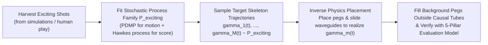

# Stochastic Processes & Inverse ("Effect-First") Level Generation

**Context:** Brainstorming note on modeling "exciting shots" as stochastic processes (over ball trajectories and score accumulation) and inverting the design pipeline: **sampling target trajectories first, then sculpting the level geometry around them**.

---

## 1. Verdict: Is This Approach Sensible?

**Yes — it is a profound and mathematically sound paradigm**, known in dynamical systems and computational design as **Inverse Billiard Synthesis** (or **Trajectory-First / Effect-First PCG**).

In standard ("forward") PCG, a generator places geometry $L$, runs the physics simulator $\Phi_L(a)$, and searches blindly for layouts that happen to produce exciting shots. By contrast, your proposal inverts the causal arrow:

However, for this to work in Peggle Evolved's exact physics engine, we must formulate the stochastic process in the **right physical coordinates** and solve **two mathematical traps** (Causal Occlusion and Lyapunov Beam Divergence).

---

## 2. How to Model "Exciting Shots" as Stochastic Processes

A Peggle shot is not an unconstrained random walk (like Brownian motion), because between collisions the ball must obey deterministic parabolic free-fall $\ddot{\mathbf{x}} = (0, g)$ or 1D rolling along a slide. The exact mathematical framework is a **Regime-Switching Piecewise-Deterministic Markov Process (PDMP)** coupled with a **Self-Exciting Hawkes Point Process**.

### 2.1 The Motion Process: Regime-Switching PDMP
A trajectory is a sequence of discrete interaction events $k = 1, 2, \dots, K$ at times $t_1 < t_2 < \dots < t_K$. Between $t_{k-1}$ and $t_k$, the motion is completely determined by the post-event state $(\mathbf{x}_{k-1}, \mathbf{v}_{k-1}^+)$.

Why can't we just sample an arbitrary next velocity $\mathbf{v}_k^+$ at time $t_k$?
Because a bounce off a stationary surface with normal $\hat{\mathbf{n}}_k = (\cos\alpha_k, \sin\alpha_k)$ and restitution $e = 0.8$ obeys:
$$\mathbf{v}_k^+ = \mathbf{v}_k^- - (1 + e)(\mathbf{v}_k^- \cdot \hat{\mathbf{n}}_k)\hat{\mathbf{n}}_k \qquad (\text{where } \mathbf{v}_k^- = \mathbf{v}_{k-1}^+ + \mathbf{g}\Delta t_k \text{ and } \mathbf{v}_k^- \cdot \hat{\mathbf{n}}_k < 0)$$
Notice that for a given incoming velocity $\mathbf{v}_k^-$, **there is only 1 degree of freedom** at a bounce: the **incidence angle** $\phi_k \in (-\pi/2, \pi/2)$ between $-\mathbf{v}_k^-$ and the surface normal $\hat{\mathbf{n}}_k$!
Once $\Delta t_k = t_k - t_{k-1}$ and $\phi_k$ are chosen:
1. The impact point $\mathbf{x}_k = \mathbf{x}_{k-1} + \mathbf{v}_{k-1}^+ \Delta t_k + \frac{1}{2}\mathbf{g}\Delta t_k^2$ is fixed.
2. The surface normal $\hat{\mathbf{n}}_k(\phi_k)$ and outgoing velocity $\mathbf{v}_k^+$ are fixed.
3. **The exact peg center $\mathbf{c}_k$ required to cause that bounce is uniquely determined**:
   $$\mathbf{c}_k = \mathbf{x}_k - (r_{\text{ball}} + r_{\text{peg}})\hat{\mathbf{n}}_k(\phi_k)$$

Therefore, we define the stochastic process in **intrinsic collision coordinates** $\{(\Delta t_k, \phi_k, Z_k)\}_{k=1}^K$, where $Z_k$ is a **Hidden Markov Regime** representing the "motif" of the shot:

| Regime $Z_k$ | Inter-Event Time $\Delta t_k$ | Deflection / Incidence $\phi_k$ | Gameplay & Visual Effect |
| :--- | :--- | :--- | :--- |
| **`PinballFlurry`** | Short ($\Delta t_k \sim \text{Gamma}$ on $0.04\text{--}0.15\text{ s}$) | Alternating signs $\phi_k \sim -\text{sign}(\phi_{k-1})\text{Beta}$ | Rapid zig-zag rattle through a dense peg cloud |
| **`SlideWaveguide`** | Continuous ($\Delta t_k = dt$, `gap = 0`) | Smooth curvature $\kappa(s)$, $\phi_k \to \pm \pi/2$ | Ball locks onto a curved ribbon/arc and sweeps 8–16 pegs |
| **`LongShotArc`** | Long ($\Delta t_k \sim 0.5\text{--}1.1\text{ s}$, $\|\Delta \mathbf{x}\| \ge 400\text{ px}$) | High upward reflection ($v_{k-1,y}^+ < 0$) | Dramatic cross-screen flight awarding `Long Shot` / `Super Long Shot` |
| **`WallBank`** | Determined by distance to $x \in \{0, W\}$ | Fixed wall normal $\hat{\mathbf{n}} = (\pm 1, 0)$ | `Off the Wall` bank shot into an interior target |
| **`RimTease`** | At $y = H - \text{bucket\_top}$ | Bucket rim bounce ($\mathbf{v}_k^+$ upward) | `Lucky Bounce` setup before final catch |

A Markov transition matrix $P(Z_k \mid Z_{k-1})$ governs the narrative arc of an exciting shot—for example:
$$\text{Launch} \longrightarrow \text{WallBank} \longrightarrow \text{SlideWaveguide} \longrightarrow \text{LongShotArc} \longrightarrow \text{PinballFlurry} \longrightarrow \text{BucketCatch}$$

### 2.2 The Score / Excitement Process: Self-Exciting Hawkes Process
Let $N(t) = \sum_{j: t_j \le t} 1$ be the counting process of scored pegs, and $S(t)$ be the cumulative turn score.
In boring shots, hits occur at a nearly constant or rapidly dying Poisson rate $\lambda(t)$. In **exciting shots**, peg hits exhibit **burstiness (clustering in time) separated by high-tension gaps**, modeled by a **Hawkes Self-Exciting Point Process**:
$$\lambda(t) = \mu(t) + \sum_{t_j < t} \alpha \, e^{-\beta (t - t_j)}$$
 paired with a **Compound Jump Process** for score $dS(t) = \Delta S_t \, dN(t)$:
- **Excitement Burstiness ($\alpha / \beta$)**: Measures how strongly one peg hit triggers an immediate cascade of subsequent hits.
- **Suspense–Climax Contrast**: The variance of inter-arrival times $\text{CV}(\Delta t) = \sigma_{\Delta t} / \bar{\Delta t}$. When $\text{CV}(\Delta t) > 1.5$, the shot alternates between rapid-fire slide/cluster flurries ($\Delta t \approx 0.03\text{ s}$) and breathtaking long-shot flights ($\Delta t \approx 0.8\text{ s}$).

> [!TIP]
> **Using Stochastic Process Models for Evaluation:**
> Once we fit the parameters $\Theta^*$ of the PDMP / Hawkes process on a corpus of "gold-standard exciting shots," we can evaluate *any* new level $L$ by computing the **log-likelihood** (or **Wasserstein distance**) of its simulated shot trajectories under $\mathcal{P}_{\Theta^*}$!

---

## 3. Inverting the Pipeline: Designing the Level Around the Trajectory

Suppose we sample $M$ "dream trajectories" $\gamma^{(1)}, \dots, \gamma^{(M)} \sim \mathcal{P}_{\text{exciting}}$ for different aim angles $a_1, \dots, a_M \in \mathcal{A}$, and we want to construct a level $L$ where those shots actually happen.

There are **two critical physical pitfalls** in naive trajectory-to-level construction, and each has a clean mathematical solution:

### Pitfall 1: The Causal Occlusion ("Time-Travel") Problem
If trajectory $\gamma$ flies through point $\mathbf{p}$ at time $t = 0.2\text{ s}$, bounces around, and later at $t = 1.5\text{ s}$ requires a peg $P_8$ to be placed near $\mathbf{p}$, then when you actually simulate the shot from $t = 0$, **the ball will collide with $P_8$ at $t = 0.2\text{ s}$** and never follow the rest of the trajectory!

**Mathematical Solution — Causal Swept-Tube Constraints:**
Every traversed trajectory segment $\gamma([0, t_k))$ sweeps out a **Forbidden Tube** of radius $R = r_{\text{ball}} + r_{\text{peg}}$:
$$\mathcal{F}_k = \left\{ \mathbf{y} \in \mathbb{R}^2 : \min_{0 \le t < t_k} \|\mathbf{y} - \gamma(t)\|_2 < r_{\text{ball}} + r_{\text{peg}} + \epsilon_{\text{margin}} \right\}$$
- **Rule 1 (Forward-Only Placement)**: No newly placed peg $\mathbf{c}_k$ ($k \ge 1$) may lie inside the union of all prior forbidden tubes $\bigcup_{m} \mathcal{F}_{k}^{(m)}$.
- **Rule 2 (Simulational Co-Generation)**: Instead of hallucinating the whole trajectory in a vacuum and placing pegs afterward, **generate the trajectory inside `PeggleSim` step-by-step**!
  - Launch ball $m$ at angle $a_m$ on the partially built board $L_{m-1}$.
  - Let `PeggleSim` advance the ball naturally through existing pegs/slides.
  - When the ball enters empty space and the stochastic process $Z_k$ calls for a bounce or a slide at $(\Delta t_k, \phi_k)$, check if $\mathbf{c}_k \notin \mathcal{F}_{\text{prior}}$. If valid, **insert the peg or slide ribbon into the live board** and continue the simulation!
  - Because `PeggleSim` itself is driving the forward rollout, **100% of constructed trajectories are guaranteed to be causal and bit-exact in the engine!**

### Pitfall 2: The "Rube Goldberg Knife-Edge" Problem (Lyapunov Divergence)
As we proved in [Literature Synthesis §2.1](file:///home/kurapica/Projects/pevo/julia_clone/wiki/brainstorming/literature_review.md#21-convex-circle-pegs-are-exponentially-dispersing-sinai-scatterers), every bounce off a circular peg magnifies angular uncertainty by $\mathcal{M}_{\text{circle}} = 1 + \frac{2\ell}{R\cos\phi} \approx 10\text{--}15\times$.
If you build a trajectory out of 8 consecutive circular-peg bounces, the range of aim angles at the launcher that successfully hits all 8 pegs shrinks as:
$$\Delta \theta_{\text{window}} \sim \frac{\pi}{\mathcal{M}_{\text{circle}}^8} \approx 10^{-9}\text{ rad} \ll \Delta \theta_{\text{grid}} = 0.00175\text{ rad}\ (0.1^\circ)$$
Even if the exact floating-point launch angle $a_m$ hits all 8 pegs, shifting aim by $\pm 1$ discrete step ($\epsilon = 1$) will miss after bounce 3! The level would feel like a frustrating lottery rather than a skillful game.

**Mathematical Solution — Waveguide Relaying (Focusing + Dispersing Alternation):**
1. **Limit consecutive free-peg bounces to $\le 2\text{--}3$**: In the Markov transition matrix $P(Z_k \mid Z_{k-1})$, after 1–2 `PinballFlurry` or `LongShotArc` bounces, transition with high probability into a **`SlideWaveguide`** (a curved zero-gap ribbon or concave arc).
2. **Use Slides as Phase-Space Funnels**: When you place a curved slide ribbon to catch the ball at $\mathbf{x}_k$, it doesn't just catch the single ray $a_m$—its concave capture mouth funnels an entire **angular beam** $[a_m - 15, a_m + 15]$ onto the exact same ribbon exit trajectory! This resets the Lyapunov divergence and keeps the shot **aimable under human motor noise $\sigma$**.

---

## 4. Concrete 4-Stage "Trajectory-First" Level Generation Algorithm

When we move to the level-generation milestone, this gives us a principled **Co-Generative Architecture**:

1. **Stage 1 — Sample Hero Skeletons (The "Highways")**:
   Choose $M \approx 4\text{--}6$ distinct launch angles (or symmetric pairs $(a_m, 1800 - a_m)$). Run the **Simulational PDMP Co-Generator** to lay down the major **Slide Waveguides** (`Ribbon`, `Arc`, `Swirl`) and key **Relay Pegs** that realize $M$ signature multi-style shots (`WallBank -> Slide -> LongShot -> Slide`), recording their causal forbidden tubes $\mathcal{F}_{\text{hero}} = \bigcup_{m=1}^M \mathcal{F}^{(m)}$.
2. **Stage 2 — Tube-Respecting Cox / Poisson-Disk Infill (The "Flesh")**:
   Fill the remaining playfield outside the hero forbidden tubes ($\mathbb{R}^2 \setminus \mathcal{F}_{\text{hero}}$) with circular scatterer pegs using an inhomogeneous Poisson-disk / spatial point process so the board reaches the target peg density ($N \approx 100\text{--}140$) without obstructing the hero highways.
3. **Stage 3 — Tactical Color Assignment**:
   Assign Red ($N_{\text{red}} \approx 20\text{--}25$) and Green ($N_{\text{green}} \approx 2$) pegs across both the hero waveguides and the scatterer clouds so that hero shots are rewarded while late-game 1v1 red-clearing remains balanced.
4. **Stage 4 — Closed-Loop Filtering & Polish via the 5-Pillar Model**:
   Run [`scripts/profile_level.jl`](file:///home/kurapica/Projects/pevo/julia_clone/scripts/profile_level.jl) to verify that the emergent board (including all 1,801 angles, not just the $M$ hero angles) achieves high $\text{LQI}(L)$, high $\text{AUC}_{\text{MI}}$, and balanced 1v1 drama.
